# Plataforma de Recaudo VAMOS — Arquitectura con ArchiMate y DDD

**Curso:** Arquitectura de Software - UPB | **Profesor:** César López | **Examen 3 (25 %)**
**Tema:** Tema 4. Recaudo del sistema integrado de transporte de una ciudad mediana | **Organización:** Metro Andino S.A
**Equipo:** Laura Carolina Suárez Lozano, Tomás Castaño Peña, Sebastian Quiceno, Sebastian Orcasita Aroca

> Solicitud del usuario: Operamos el sistema integrado de transporte de la ciudad, con tres modos: buses alimentadores (satélites), buses articulados en carriles exclusivos y metro. Necesitamos un software que apoye el proceso de recaudo, que está ligado directamente a la operación, y que permita a residentes y visitantes pagar su viaje de forma ágil y con la tarifa que les corresponde.

## Índice

1. [Contexto y entrevista](#1-contexto-y-entrevista)
2. [Motivación](#2-motivación) - [V1](#v1-motivación)
3. [Mapa de capacidades y proceso E2E](#3-mapa-de-capacidades-y-proceso-e2e) - [V2](#v2-mapa-de-capacidades), [V3](#v3-cadena-de-valor-y-proceso-e2e)
4. [Descomposición de servicios](#4-descomposición-de-servicios) - [V4](#v4-descomposición-de-servicios), [V4b](#v4b-capa-anticorrupción), [V4c](#v4c-contratos-de-servicio), [V4d](#v4d-detalle-de-los-subdominios-foco), [Inclusión/exclusión](#tabla-de-inclusión-y-exclusión), [Externos](#servicios-externos-capa-anticorrupción), [Contratos](#contratos-contract-first)
5. [Dominios y lenguaje ubicuo](#5-dominios-y-lenguaje-ubicuo) - [Ecosistema](#ecosistema) - [Tormenta de eventos](#tormenta-de-eventos), [V5](#v5-dominios) - [V7](#v7-lenguaje-ubicuo), [V7b](#v7b-homónimos-entre-contextos)
6. [Agregados, comandos y eventos](#6-agregados-comandos-y-eventos) - [V6](#v6-agregados-comandos-y-eventos), [Fichas](#fichas-de-agregados)
7. [Mapa de contextos e interoperabilidad](#7-mapa-de-contextos-e-interoperabilidad) - [V8](#v8-mapa-de-contextos), [V9](#v9-interoperabilidad-y-anticorrupción), [V10](#v10-trazabilidad-vertical)
8. [Bounded Context Canvas](#8-bounded-context-canvas) - [V11](#v11-bounded-context-canvas)
9. [Decisiones y supuestos](#9-decisiones-y-supuestos)
10. [Tabla de aportes](#10-tabla-de-aportes)

Modelo fuente: [`/modelo`](modelo/) - Imágenes de vistas: [`/vistas`](vistas/) - Entrevista: [`/entrevista`](entrevista/)

---

## 1. Contexto y entrevista

**Metro Andino S.A.** es el ente gestor, 100 % público, del Sistema Integrado de Transporte (SIT) de **Villa Andina**, una ciudad intermedia colombiana ficticia de unos 900.000 habitantes. El SIT tiene tres modos: una línea de metro, dos troncales de buses articulados (BRT) y 45 rutas de buses alimentadores. Mueve cerca de 380.000 validaciones en un día hábil con la tarjeta propia **VAMOS**.

Los buses los operan tres concesionarios y el metro lo opera la OMVA. El **recaudo** está concesionado a la Unión Temporal Recaudo Andino (**URA**) hasta el **31 de diciembre de 2027**, y el dinero lo administra un patrimonio autónomo de la Fiduciaria Cordillera. Metro Andino decidió no prorrogar la concesión y ser dueña del sistema central y de los datos. De ahí nace la **Plataforma de Recaudo VAMOS**. Debe operar desde el 1 de enero de 2028, cobrar a cada usuario la tarifa que le corresponde (perfiles especiales y transbordos), aceptar tarjetas bancarias para los visitantes y consolidar el recaudo como base para distribuir ingresos a los operadores.

**Entrevista al experto (Fase 0).** Se configuró una sesión de IA en el rol de Gerente de Recaudo y Medios de Pago de Metro Andino y se le aplicó un guion de 53 preguntas en 12 bloques, con un bloque específico de interoperabilidad.

- Instrucción de rol: [entrevista/instruccion-rol.md](entrevista/instruccion-rol.md)
- Guion: [entrevista/guion.md](entrevista/guion.md)
- Conversación completa: [entrevista/conversacion.md](entrevista/conversacion.md)
- Análisis de hallazgos: [entrevista/analisis-hallazgos.md](entrevista/analisis-hallazgos.md)

Del análisis salieron **32 hallazgos validados por el equipo**: 10 contrastados con fuentes externas y 2 descartados. Los que más cambiaron el diseño:
- la restricción más dura es el **plazo del 1 de enero de 2028**, no los dispositivos (H11);
- el proceso de punta a punta tiene **11 pasos**, no los 7 que suponíamos (H15);
- la gestión tarifaria y la de beneficiarios son **capacidades distintas** (H13);
- en BRT y metro el recaudo se consolida **por estación y troncal**, no por ruta (H18);
- tres normas verificadas: Decreto 090 de 2018, PCI DSS v4.0.1 y Resolución 1197 de 2024 (H27–H29).

## 2. Motivación

### V1 Motivación
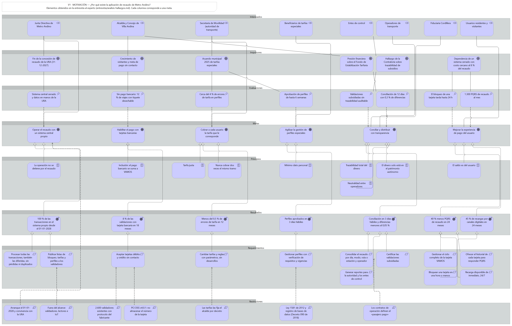

**Análisis.** La vista responde por qué existe la aplicación. Se lee por **columnas, una por meta**: cada columna reúne a los interesados, impulsores, evaluaciones, principios, resultados, requerimientos y restricciones que justifican esa meta. Todos los elementos salen de la entrevista; cada uno tiene en Archi la propiedad `fuente` con el hallazgo y la pregunta de origen.

| Meta | Impulsor principal | Evaluación (situación actual) | Resultado medible | Requerimientos que la realizan |
|---|---|---|---|---|
| Operar el recaudo con un sistema central propio | Fin de la concesión de la URA (31-12-2027) | Sistema cerrado y datos en manos de la URA | 100 % de las transacciones en el sistema propio desde el 01-01-2028 | Procesar todas las transacciones sin pérdidas ni duplicados; publicar listas y parámetros a los validadores |
| Habilitar el pago con tarjetas bancarias | Crecimiento de visitantes y meta de pago sin contacto | 12 % de viajes con tiquete desechable, sin pago bancario | 8 % de validaciones bancarias en 18 meses | Aceptar débito y crédito sin contacto |
| Cobrar a cada usuario la tarifa que le corresponde | Acuerdo municipal 2025 de tarifas especiales | ≈4 % de errores de tarifa en perfiles | Menos del 0,5 % de errores en 12 meses | Cambiar tarifas y reglas con parámetros |
| Agilizar la gestión de perfiles especiales | Acuerdo municipal 2025 | Aprobación de hasta 6 semanas | Perfiles aprobados en 3 días hábiles | Gestionar perfiles con verificación y vigencias |
| Conciliar y distribuir con transparencia | Presión sobre el FET; hallazgo de la Contraloría | Conciliación de 12 días; subsidios sin trazabilidad | Conciliación en 3 días y diferencias < 0,05 % | Consolidar el recaudo; certificar subsidios; reportes regulatorios |
| Mejorar la experiencia de pago del usuario | Dependencia de un sistema cerrado | Bloqueo de hasta 24 h; 1.300 PQRS al mes | −40 % PQRS; 45 % de recarga digital | Ciclo completo de VAMOS; historial para PQRS; bloqueo en ≤ 1 h; recarga inmediata 24/7 |

Las **restricciones** limitan los requerimientos: el plazo de 2028 y la convivencia con la URA, los validadores fuera del alcance, los 2.600 equipos existentes, PCI DSS v4.0.1, las tarifas por decreto, la Ley 1581 de 2012 y los contratos que definen el "pasajero pago". Los **principios** (tarifa justa, nunca cobrar dos veces, el saldo es del usuario, trazabilidad total, entre otros) realizan las metas y en la Fase 4 se vuelven invariantes de los agregados.

**Decisiones.**
- Relaciones usadas, todas válidas en ArchiMate 3.2: interesado *asociación* impulsor o meta; impulsor *asociación* evaluación; evaluación *influencia* meta; resultado y principio *realizan* la meta; requerimiento *realiza* el resultado; restricción *influye* sobre la meta o el requerimiento que limita.
- Se incluyó el impulsor "Dependencia de un sistema cerrado" (I6 del resumen del experto, P53.1). Explica las evaluaciones de bloqueo lento y PQRS.
- Las cifras de evaluaciones y resultados son estimaciones del experto. Se tratan como supuestos (hallazgos H06 y H07).

## 3. Mapa de capacidades y proceso E2E

### V2 Mapa de capacidades
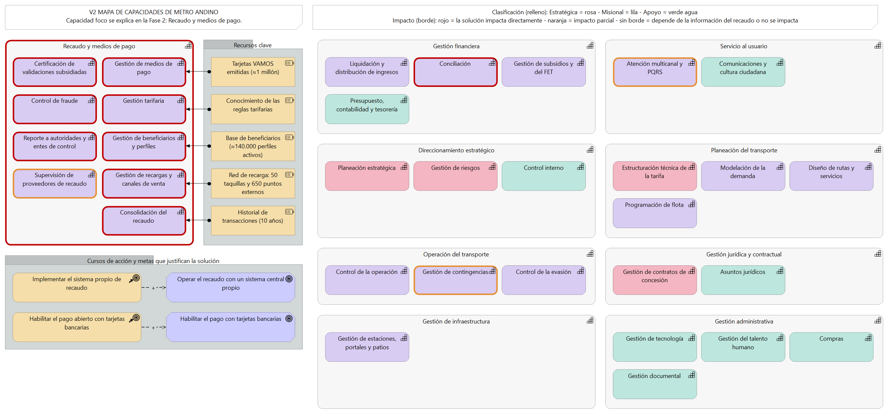

**Análisis.** El mapa cubre **todo el negocio de Metro Andino**, no solo la aplicación, siguiendo el formato del curso (mapa de capacidades de la IPS, presentación de SOA, diap. 35). Tiene 9 capacidades de nivel 1, una por área, y 32 de nivel 2: 4 estratégicas, 20 misionales y 8 de apoyo.

- **Capacidad foco:** *Recaudo y medios de pago* (borde rojo). Es la que se desglosa en servicios en la Fase 2.
- **9 capacidades con impacto directo** (borde rojo): las 8 de recaudo (medios de pago, tarifas, beneficiarios y perfiles, recargas y canales, consolidación, certificación de subsidios, control de fraude y reportes) más la *Conciliación* de Gestión financiera.
- **3 con impacto parcial** (borde naranja): supervisión de proveedores de recaudo, atención y PQRS, y gestión de contingencias.
- **Sin borde:** capacidades que dependen de la información del recaudo (liquidación, planeación de la demanda, control de la evasión) o que no se impactan.

Los **recursos clave** están asignados a la capacidad que sostienen: tarjetas emitidas, reglas tarifarias, base de beneficiarios, red de recarga e historial de transacciones. Los **cursos de acción** "Implementar el sistema propio de recaudo" y "Habilitar el pago abierto con tarjetas bancarias" influyen positivamente en las metas de V1. Así el mapa queda conectado con la motivación.

**Decisiones.**
- La clasificación estratégica, misional o de apoyo es **por capacidad**, no por área, como en el ejemplo de la IPS. Por ejemplo, Control interno es de apoyo aunque está en Direccionamiento estratégico.
- *Gestión tarifaria* y *Gestión de beneficiarios y perfiles* van separadas (H13): cambian a ritmos distintos y tienen responsables distintos.
- El área administrativa, que el experto agrupó en una sola capacidad, se desagregó en 4: tecnología, talento humano, compras y gestión documental. Una capacidad se nombra con un sustantivo de gestión, no como lista. Por eso son 32 capacidades y no las 29 de la entrevista.
- La liquidación y la distribución quedan **sin impacto directo** (H14): la aplicación entrega la base y Financiera liquida.
- Las asociaciones entre el curso de acción y cada capacidad impactada están en el modelo, pero no se dibujan en la vista para no saturarla. Se usarán en la vista de trazabilidad (V10).

### V3 Cadena de valor y proceso E2E
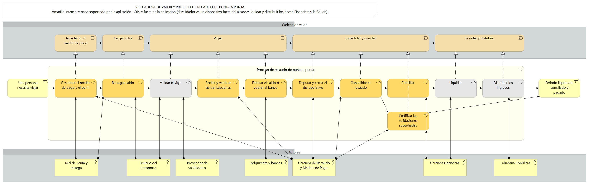

**Análisis.** Arriba está la **cadena de valor** de 5 etapas, desde la perspectiva de quien viaja y de quien recibe el dinero: acceder a un medio de pago, cargar valor, viajar, consolidar y conciliar, y liquidar y distribuir. Debajo está el **proceso de recaudo de punta a punta**, con los 11 pasos validados por el experto (H15). Empieza con el evento "Una persona necesita viajar" y termina con "Periodo liquidado, conciliado y pagado". Cada paso realiza su etapa de valor y tiene asignado el actor que lo ejecuta.

**Dónde se ubica la aplicación** (amarillo intenso): soporta 8 de los 11 pasos.

| Paso | ¿La aplicación lo soporta? | Por qué |
|---|---|---|
| Gestionar el medio de pago y el perfil; Recargar saldo | Sí | Ciclo de VAMOS, perfiles y recargas (alcance del tema) |
| Validar el viaje | **No** (gris) | Ocurre en el validador, un dispositivo fuera del alcance. La aplicación le entrega tarifas y listas y recibe sus transacciones |
| Recibir y verificar; Debitar o cobrar; Depurar y cerrar el día | Sí | Núcleo del recaudo: tarifa, transbordo, saldo, cobro bancario diferido, cierre provisional y definitivo |
| Consolidar; Conciliar; Certificar subsidios | Sí | Consolidado por modo, ruta o estación y operador; base de conciliación y certificación |
| Liquidar; Distribuir los ingresos | **No** (gris) | Los hacen la Gerencia Financiera y la fiducia (H14) |

**Decisiones.**
- El proceso E2E es un proceso de negocio que **se compone** de sus pasos (anidados). Los eventos inicial y final quedan fuera del contenedor porque ArchiMate no permite que un proceso se componga de eventos: se unen con *disparo*.
- *Certificar las validaciones subsidiadas* es una rama mensual que sale de *Consolidar*, no un paso de la secuencia diaria.
- En esta fase los participantes se modelan como **actores de negocio**. Los roles (analista de recaudo, coordinación de beneficiarios…) se precisan en la Fase 2, al asignarlos a los servicios.
- Los 11 pasos de esta vista son la **capa 1** de la descomposición de servicios (V4).

## 4. Descomposición de servicios

### V4 Descomposición de servicios
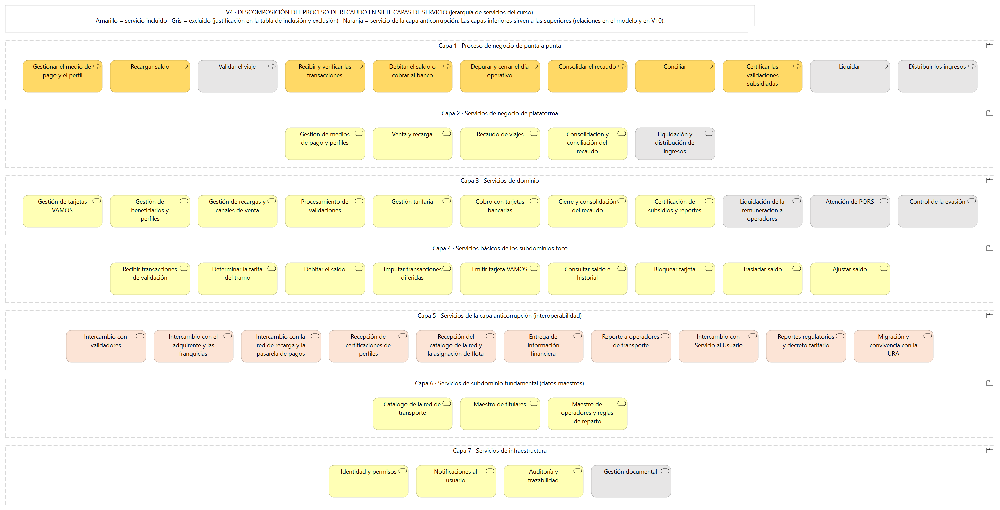

**Análisis.** El proceso de recaudo se descompone en las **siete capas de la jerarquía de servicios del curso** (presentación de SOA, diapositivas 20 y 28; el enunciado exige mínimo cuatro). La capa 1 son los 11 pasos del proceso E2E de V3 y cada capa inferior sirve a la superior.

| Capa | Qué contiene | Servicios (incluidos) | Equipo dueño |
|---|---|---|---|
| 1 - Proceso E2E | Los 11 pasos de V3 (8 soportados por la plataforma) | — | Proceso de recaudo (equipo virtual) |
| 2 - Negocio de plataforma | Unidades que orquestan pasos del E2E | 5 (4) | Gerencia de Recaudo y Medios de Pago |
| 3 - Dominio | Un servicio por subdominio funcional | 11 (8) | Equipos de subdominio |
| 4 - Básicos de los subdominios foco | Servicios del tamaño final de *Procesamiento de validaciones* y *Gestión de tarjetas VAMOS* | 9 (9) | Equipos de Validaciones y de Tarjetas |
| 5 - Anticorrupción | Un servicio por cada frontera con un externo | 10 (10) | Equipos de subdominio |
| 6 - Subdominio fundamental | Datos maestros compartidos | 3 (3) | Datos maestros |
| 7 - Infraestructura | Servicios transversales, independientes del negocio | 4 (3) | Tecnología |

**Criterio de granularidad.** Un servicio de tamaño final ofrece una **función empresarial discreta** (principio de granularidad de SOA). Para cada servicio se respondieron las preguntas del curso (presentación de SOA, diap. 39): quiénes lo consumen, dónde y cómo se consume, qué desempeño exige y cuál es su límite comercial. Ese límite está en la columna "No debe administrar" de la tabla de inclusión. Como en el ejemplo del curso (agendamiento de citas, donde solo se desglosa *Gestión de citas*), en la capa 4 solo se desglosan los **dos subdominios foco**:
- *Procesamiento de validaciones*: la regla diferenciadora de "la tarifa que corresponde".
- *Gestión de tarjetas VAMOS*: el ciclo completo de la tarjeta, la recarga inmediata y el bloqueo en una hora.

Los demás servicios de dominio ya tienen tamaño final y llevan su propio contrato.

**Decisiones.**
- Cada capa es un elemento **Agrupación** de ArchiMate que agrega sus servicios. Los servicios son **servicios de negocio** (amarillos), como pide el enunciado.
- Como en la diapositiva 28 del curso, la vista se lee por posición y **no dibuja las líneas entre capas**. Las relaciones *servicio (serving)* de cada servicio hacia el de la capa superior sí están en el modelo y se usan en la trazabilidad (V10).
- Los servicios excluidos se dejan visibles en gris para que se vea qué queda fuera y por qué. Los de la capa anticorrupción van en naranja, como los óvalos de la jerarquía del curso.

### V4b Capa anticorrupción
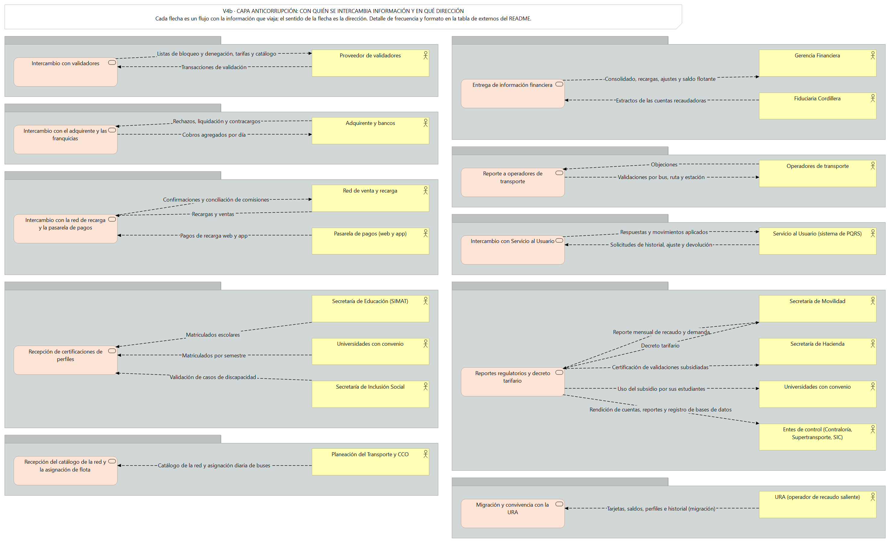

**Análisis.** Los 10 servicios de la capa 5 aíslan a la plataforma de **17 externos**. Cada flecha es un flujo con la información que viaja; su sentido es la dirección. Están cubiertos los cinco tipos que pide el enunciado:
- **dispositivos:** validadores;
- **sistemas legados:** el ERP de 2012, los sistemas de Planeación y del CCO, el sistema de la URA;
- **proveedores:** adquirente, red de recarga, pasarela, fiducia, mensajería;
- **procesos internos:** Financiera, Servicio al Usuario, Planeación;
- **entidades regulatorias y públicas:** Secretarías de Movilidad, Hacienda, Educación e Inclusión Social, universidades, entes de control.

La integración con la DIAN se retiró por el hallazgo H30. El detalle de frecuencia y formato está en la tabla de servicios externos, más abajo.

**Decisiones.** Hay un servicio anticorrupción por cada frontera. En casi todas, **el formato lo define el otro** (fabricante, adquirente, fiducia, ERP, entes) o el otro es un sistema legado difícil de cambiar (H31). Traducir en la frontera evita que esa semántica contamine el modelo del recaudo. Esta tabla de externos es la **fuente única** para el mapa de contextos y la vista de interoperabilidad de la Fase 5 (V8 y V9).

### V4c Contratos de servicio
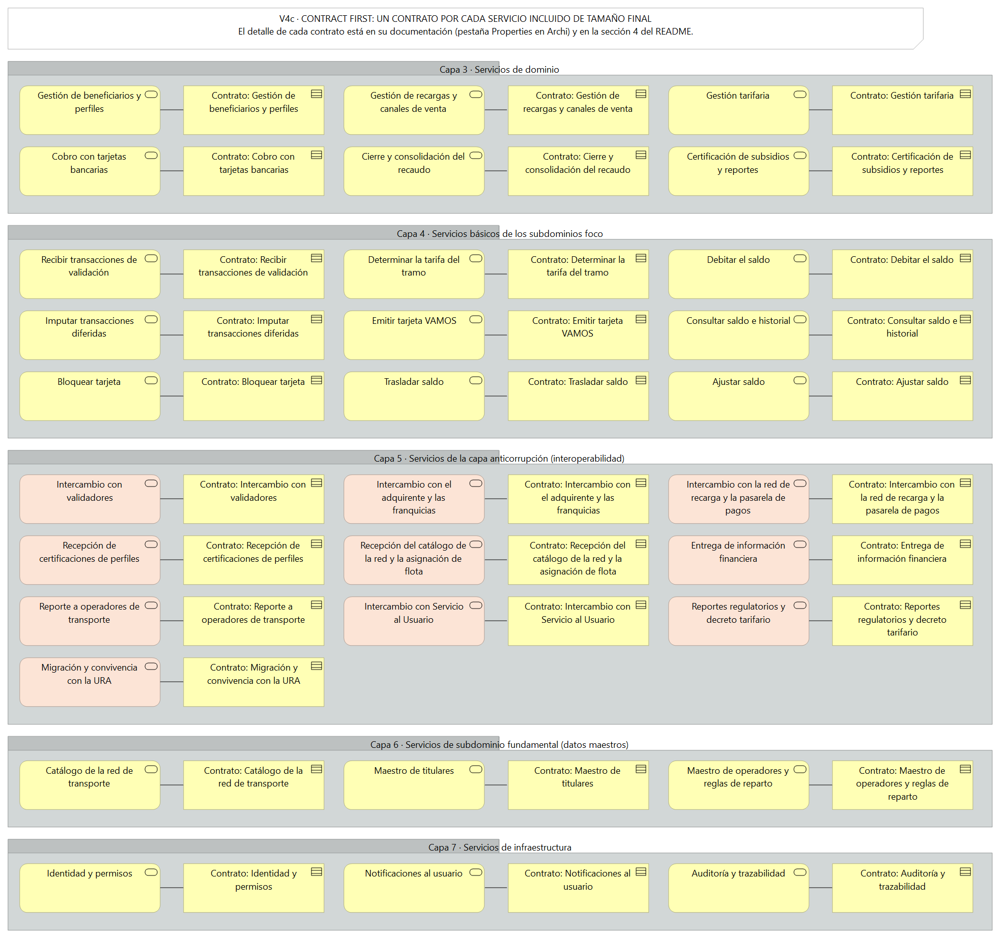

**Análisis.** Siguiendo **Contract First** (presentación de SOA, P3), cada servicio incluido de tamaño final tiene un **contrato**, que es un objeto pasivo de negocio asociado al servicio. Son 31 contratos:
- 21 de servicios de dominio, básicos, fundamentales y de infraestructura, detallados en la tabla de contratos con entrada, salida, precondiciones, postcondiciones, errores y estilo;
- 10 de la capa anticorrupción, cuyo contenido es el intercambio de la tabla de externos.

En Archi el detalle está en la documentación de cada contrato. Todos son versión v1: los cambios futuros agregan campos, no los modifican.

### V4d Detalle de los subdominios foco
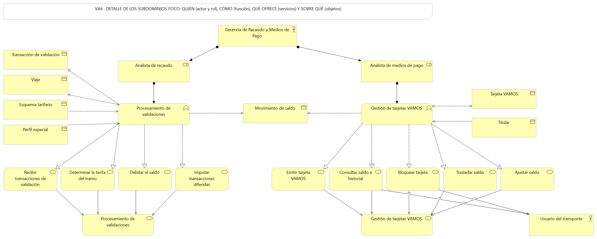

**Análisis.** Completa los servicios con **actores, roles, funciones y objetos pasivos**, como pide el enunciado. La Gerencia de Recaudo cumple dos roles: el *Analista de recaudo* está asignado a la función *Procesamiento de validaciones* y el *Analista de medios de pago* a *Gestión de tarjetas VAMOS*. Cada función **realiza** sus servicios básicos, que a su vez **sirven** al servicio de dominio. Las funciones **acceden** a los objetos de negocio del glosario:
- *Procesamiento de validaciones* escribe la transacción de validación y el movimiento de saldo, lee el esquema tarifario y el perfil especial, y lee y escribe el viaje.
- *Gestión de tarjetas VAMOS* lee y escribe la tarjeta, escribe el movimiento de saldo y lee el titular.

El usuario del transporte es servido por *Consultar saldo e historial* y *Bloquear tarjeta*.

### Tabla de inclusión y exclusión

| Capa | Servicio | Decisión | Justificación | No debe administrar |
|---|---|---|---|---|
| 2 | Gestión de medios de pago y perfiles | Incluido | Orquesta el paso «Gestionar el medio de pago y el perfil» del E2E; agrupa las capacidades foco de medios de pago y beneficiarios | El dinero del usuario (lo custodia la fiducia) |
| 2 | Venta y recarga | Incluido | Orquesta el paso «Recargar saldo»: es donde el dinero entra al sistema y donde se mide la meta de 45 % de recarga digital | La liquidación de comisiones de la red (Financiera) |
| 2 | Recaudo de viajes | Incluido | Orquesta recibir, debitar o cobrar: concentra las metas de tarifa correcta y pago bancario | Los validadores (dispositivos fuera del alcance) |
| 2 | Consolidación y conciliación del recaudo | Incluido | Orquesta cerrar, consolidar, conciliar y certificar: la base de distribución pasa a Metro Andino en 2028 | La liquidación y la orden de pago (Financiera) |
| 2 | Liquidación y distribución de ingresos | Excluido | Liquidar y distribuir los ejecutan Financiera y la fiducia (H14); la plataforma solo entrega la base por la capa anticorrupción | -- |
| 3 | Gestión de tarjetas VAMOS | Incluido | Ciclo completo de VAMOS (emisión, saldo, bloqueo, traslado): requerimiento explícito del tema. Subdominio foco: se desglosa en la capa 4 | Los datos de tarjetas bancarias |
| 3 | Gestión de beneficiarios y perfiles | Incluido | Alcance del tema (validar que el usuario cumple su perfil) y meta de aprobar perfiles en 3 días; separada de la gestión tarifaria (H13) | La certificación de la condición (la hacen Educación, universidades e Inclusión Social) |
| 3 | Gestión de recargas y canales de venta | Incluido | Recarga disponible de inmediato 24/7 y conciliación diaria con la red de recarga | La operación de los puntos de venta (operador de venta) |
| 3 | Procesamiento de validaciones | Incluido | Recibe las transacciones y aplica la tarifa en cada validación: es el corazón de «la tarifa que corresponde». Subdominio foco: se desglosa en la capa 4 | El estado y el software de los validadores |
| 3 | Gestión tarifaria | Incluido | Reglas parametrizables y decreto aplicado en 5 días hábiles; separada de perfiles porque cambia una vez al año (H13) | El valor de la tarifa (lo decreta el alcalde) |
| 3 | Cobro con tarjetas bancarias | Incluido | Meta de 8 % de pago bancario; cobro diferido agregado por día y deuda de viaje (H16, H23) | El número de la tarjeta (se usa el token del adquirente, PCI DSS) |
| 3 | Cierre y consolidación del recaudo | Incluido | Consolidado por modo, ruta o estación y operador (alcance del tema), con cierre provisional en D+1 y definitivo en D+3 (H17, H18) | El cálculo de la remuneración de los operadores |
| 3 | Certificación de subsidios y reportes | Incluido | Responde al hallazgo de la Contraloría y a los reportes que exigen la autoridad y los entes de control (H03, H05) | El cobro del subsidio a la Alcaldía (Financiera) |
| 3 | Liquidación de la remuneración a operadores | Excluido | Capacidad de la Gerencia Financiera (H14); usa el consolidado como insumo | - |
| 3 | Atención de PQRS | Excluido | Lo gestiona Servicio al Usuario en su sistema de PQRS; la plataforma le ofrece historial y ajustes por la capa anticorrupción | - |
| 3 | Control de la evasión | Excluido | Capacidad de Operaciones medida con conteos manuales (H26); solo recibe datos de validaciones | - |
| 4 | Recibir transacciones de validación | Incluido | Recibe el 100 % de las transacciones, en línea o por lotes, sin duplicarlas (requerimiento de procesamiento completo) | El estado de los equipos |
| 4 | Determinar la tarifa del tramo | Incluido | Aplica perfil vigente, cupo y transbordo; es la regla que más cambia, por eso se aísla | El valor de las tarifas (lo publica Gestión tarifaria) |
| 4 | Debitar el saldo | Incluido | Garantiza un solo cobro por tramo y el viaje a crédito de las personalizadas | Los cobros bancarios (Cobro con tarjetas bancarias) |
| 4 | Imputar transacciones diferidas | Incluido | Las transacciones de alimentadores llegan hasta 7 días tarde: se imputan al día en que ocurrieron (H17) | Una liquidación ya pagada (se ajusta en la siguiente) |
| 4 | Emitir tarjeta VAMOS | Incluido | Primer paso del ciclo de VAMOS, anónima o personalizada | La producción física de la tarjeta (operador de venta) |
| 4 | Consultar saldo e historial | Incluido | Saldo e historial 24/7 para el usuario y para responder PQRS | La respuesta de la PQRS |
| 4 | Bloquear tarjeta | Incluido | Meta de bloquear en una hora o menos; publica la tarjeta en la lista de bloqueo | La carga de la lista en cada equipo |
| 4 | Trasladar saldo | Incluido | Principio «el saldo es del usuario»: traslado a una tarjeta nueva después de 72 h | — |
| 4 | Ajustar saldo | Incluido | Compensaciones por cobro sin paso, recarga no aplicada o contingencia (H24) | La PQRS que lo origina |
| 5 | Intercambio con validadores | Incluido | Protocolo propietario de 2.600 equipos que Metro Andino no controla: se traduce para no contaminar el modelo | Inventario, mantenimiento y software de los equipos |
| 5 | Intercambio con el adquirente y las franquicias | Incluido | Formatos impuestos por adquirente y franquicias; tokenización exigida por PCI DSS | Datos de tarjeta en claro |
| 5 | Intercambio con la red de recarga y la pasarela de pagos | Incluido | El agregador y la pasarela tienen sus propios formatos; conciliación diaria con diferencias hoy | - |
| 5 | Recepción de certificaciones de perfiles | Incluido | Cada entidad entrega en su formato (SIMAT, Excel, papel) | La certificación misma |
| 5 | Recepción del catálogo de la red y la asignación de flota | Incluido | Sistemas legados de Planeación y del CCO que solo exportan archivos; la asignación diaria evita imputar al operador equivocado | La programación de la flota |
| 5 | Entrega de información financiera | Incluido | ERP de 2012 y portal de la fiducia: la plataforma se adapta a sus formatos | La contabilidad y la liquidación |
| 5 | Reporte a operadores de transporte | Incluido | Reporte diario de validaciones por bus, ruta y estación y recepción de objeciones (3 días hábiles) | - |
| 5 | Intercambio con Servicio al Usuario | Incluido | Historial y ajustes para el sistema de PQRS existente | La gestión de la PQRS |
| 5 | Reportes regulatorios y decreto tarifario | Incluido | Formatos impuestos por cada ente; incluye la recepción del decreto tarifario | - |
| 5 | Migración y convivencia con la URA | Incluido | Temporal: migración de masomenos 1 millón de tarjetas y  aproximadamente 9.000 millones de saldo, y convivencia hasta 2027 | - |
| 6 | Catálogo de la red de transporte | Incluido | Datos maestros que usan validaciones y consolidación; su dueño es Planeación y la plataforma mantiene la copia que necesita | La planeación de rutas |
| 6 | Maestro de titulares | Incluido | Datos personales mínimos (Ley 1581) compartidos por tarjetas y perfiles | Datos de tarjetas bancarias |
| 6 | Maestro de operadores y reglas de reparto | Incluido | Factor de reparto de las estaciones compartidas y definición contractual de pasajero pago | Los contratos |
| 7 | Identidad y permisos | Incluido | Doble control de las reglas tarifarias (registra el analista, aprueba la Gerente) y perfiles de acceso de funcionarios | El directorio corporativo |
| 7 | Notificaciones al usuario | Incluido | Avisos de vencimiento de perfil, recarga y bloqueo, enviados por un proveedor de mensajería | El contenido de campañas |
| 7 | Auditoría y trazabilidad | Incluido | Principio de trazabilidad total: ninguna transacción se borra y todo cambio de parámetros queda registrado | - |
| 7 | Gestión documental | Excluido | Los soportes de perfiles y las actas se guardan en el sistema documental corporativo de la Gerencia Administrativa | - |

### Servicios externos (capa anticorrupción)

| Servicio anticorrupción | Externo | Tipo | Información | Dirección | Frecuencia | Formato lo define |
|---|---|---|---|---|---|---|
| Intercambio con validadores | Proveedor de validadores | Dispositivo | Transacciones de validación | -> plataforma | En línea o lote diario | Fabricante |
| Intercambio con validadores | Proveedor de validadores | Dispositivo | Listas de bloqueo y denegación, tarifas y catálogo | plataforma -> | Casi en tiempo real | Fabricante |
| Intercambio con el adquirente y las franquicias | Adquirente y bancos | Proveedor | Cobros agregados por día | plataforma -> | Diaria | Adquirente y franquicias |
| Intercambio con el adquirente y las franquicias | Adquirente y bancos | Proveedor | Rechazos, liquidación y contracargos | -> plataforma | Diaria (D+1) | Adquirente y franquicias |
| Intercambio con la red de recarga y la pasarela de pagos | Red de venta y recarga | Proveedor | Recargas y ventas | -> plataforma | En línea | Agregador |
| Intercambio con la red de recarga y la pasarela de pagos | Red de venta y recarga | Proveedor | Confirmaciones y conciliación de comisiones | plataforma -> | En línea y diaria | Metro Andino (conciliación) |
| Intercambio con la red de recarga y la pasarela de pagos | Pasarela de pagos (web y app) | Proveedor | Pagos de recarga web y app | -> plataforma | En línea | Pasarela |
| Recepción de certificaciones de perfiles | Secretaría de Educación (SIMAT) | Entidad | Matriculados escolares | -> plataforma | Anual | Secretaría de Educación |
| Recepción de certificaciones de perfiles | Universidades con convenio | Entidad | Matriculados por semestre | -> plataforma | Semestral | Metro Andino (convenio) |
| Recepción de certificaciones de perfiles | Secretaría de Inclusión Social | Entidad | Validación de casos de discapacidad | -> plataforma | A demanda | Secretaría de Inclusión |
| Recepción del catálogo de la red y la asignación de flota | Planeación del Transporte y CCO | Proceso interno (sistemas legados) | Catálogo de la red y asignación diaria de buses | -> plataforma | Por cambio y diaria | Metro Andino |
| Entrega de información financiera | Gerencia Financiera (ERP y liquidación) | Proceso interno (sistema legado) | Consolidado, recargas, ajustes y saldo flotante | plataforma -> | Diaria y mensual | ERP |
| Entrega de información financiera | Fiduciaria Cordillera | Proveedor | Extractos de las cuentas recaudadoras | -> plataforma | Diaria | Fiducia |
| Reporte a operadores de transporte | Operadores de transporte | Entidad (concesionarios) | Validaciones por bus, ruta y estación | plataforma -> | Diaria | Metro Andino |
| Reporte a operadores de transporte | Operadores de transporte | Entidad (concesionarios) | Objeciones | -> plataforma | Semanal (3 días hábiles) | Metro Andino |
| Intercambio con Servicio al Usuario | Servicio al Usuario (sistema de PQRS) | Proceso interno | Solicitudes de historial, ajuste y devolución | -> plataforma | Diaria | Metro Andino |
| Intercambio con Servicio al Usuario | Servicio al Usuario (sistema de PQRS) | Proceso interno | Respuestas y movimientos aplicados | plataforma -> | Diaria | Metro Andino |
| Reportes regulatorios y decreto tarifario | Secretaría de Movilidad | Entidad regulatoria | Decreto tarifario | -> plataforma | Anual | Secretaría de Movilidad |
| Reportes regulatorios y decreto tarifario | Secretaría de Movilidad | Entidad regulatoria | Reporte mensual de recaudo y demanda | plataforma -> | Mensual | Secretaría de Movilidad |
| Reportes regulatorios y decreto tarifario | Secretaría de Hacienda | Entidad | Certificación de validaciones subsidiadas | plataforma -> | Mensual | Hacienda |
| Reportes regulatorios y decreto tarifario | Universidades con convenio | Entidad | Uso del subsidio por sus estudiantes | plataforma -> | Mensual | Metro Andino (convenio) |
| Reportes regulatorios y decreto tarifario | Entes de control (Contraloría, Supertransporte, SIC) | Entidad regulatoria | Rendición de cuentas, reportes y registro de bases de datos | plataforma -> | Anual o a demanda | Cada ente |
| Migración y convivencia con la URA | URA (operador de recaudo saliente) | Sistema legado | Tarjetas, saldos, perfiles e historial (migración) | -> plataforma | Única + convivencia hasta 2027 | URA (por definir) |
| Notificaciones al usuario | Proveedor de mensajería (SMS y correo) | Proveedor | Avisos de vencimiento, recarga y bloqueo | plataforma -> | Por evento | Proveedor |

### Contratos (Contract First)

Contratos de los servicios incluidos de tamaño final, salvo los 10 de la capa anticorrupción, cuyo contrato es el intercambio de la tabla anterior.

| Capa | Servicio | Entrada -> Salida | Precondiciones | Postcondiciones | Errores de negocio | Estilo y SLA |
|---|---|---|---|---|---|---|
| 3 | Gestión de beneficiarios y perfiles | Titular, tipo de perfil y soportes -> Perfil con estado, vigencia y cupo mensual | VAMOS personalizada; sin otro perfil activo; no inhabilitado por fraude | Perfil activo con vigencia y cupo; aviso 30 días antes del vencimiento | Requisitos no cumplidos - perfil duplicado - titular inhabilitado | Solicitud síncrona y aprobación asíncrona - aprobación en ≤ 3 días hábiles |
| 3 | Gestión de recargas y canales de venta | Tarjeta, valor, canal y referencia de pago -> Comprobante y saldo disponible | Valor entre 2.000 y 100.000 COP; saldo resultante ≤ 200.000; tarjeta no bloqueada | Saldo disponible de inmediato; movimiento de recarga registrado | Monto fuera de rango - tarjeta bloqueada - pago no confirmado | Síncrono, 24/7 |
| 3 | Gestión tarifaria | Esquema tarifario: tarifas por perfil, reglas de transbordo, cupos y fecha de vigencia -> Esquema versionado y vigente | Decreto o resolución registrado; doble control (registra el analista, aprueba la Gerente) | Nueva versión vigente desde su fecha y publicada a los validadores | Sin aprobación - vigencias superpuestas | Síncrono - decreto aplicado en ≤ 5 días hábiles |
| 3 | Cobro con tarjetas bancarias | Token de la tarjeta y tramos del día -> Cobro agregado diario con estado (pagado, rechazado) | Token fuera de la lista de denegación | Un cargo por tarjeta y día; si se rechaza: deuda de viaje, lista de denegación y hasta 3 reintentos | Rechazo del emisor - contracargo | Asíncrono, lote diario después del cierre - riesgo máximo de 1 día por tarjeta |
| 3 | Cierre y consolidación del recaudo | Día operativo -> Consolidado por modo, ruta o estación, operador, franja, perfil y medio; base de liquidación | Transacciones del día recibidas y depuradas | Cierre provisional (D+1) y definitivo (D+3); lo tardío se ajusta en la siguiente liquidación | Transacciones pendientes de depurar - bus sin asignación a ruta | Asíncrono, lote diario |
| 3 | Certificación de subsidios y reportes | Periodo y entidad financiadora o ente de control -> Certificado de validaciones subsidiadas con anexo; reportes | Todos los días del periodo con cierre definitivo | Cada cifra trazable hasta la validación que la origina | Periodo sin cierre definitivo | Asíncrono, mensual |
| 4 | Recibir transacciones de validación | Transacción o lote: equipo, fecha y hora, medio de pago, estación o ruta -> Acuse de recibo | Equipo registrado en el catálogo | Cada transacción registrada una sola vez (idempotencia) | Transacción duplicada - equipo desconocido | Asíncrono, en línea o por lotes (hasta 7 días de atraso) - 40.000 validaciones en hora pico |
| 4 | Determinar la tarifa del tramo | Transacción, perfil vigente y viaje en curso -> Tarifa del tramo: plena, del perfil, 0 o cargo de transbordo | Esquema tarifario vigente en la fecha de la validación | Tramo asociado al viaje (máximo 3 tramos en 90 min) | Sin esquema vigente | Síncrono, interno |
| 4 | Debitar el saldo | Tarjeta y valor del tramo -> Saldo antes y después | Tarjeta activa; saldo suficiente o viaje a crédito disponible | Un solo débito por tramo | Tarjeta bloqueada - saldo insuficiente | Síncrono, interno |
| 4 | Imputar transacciones diferidas | Transacción con fecha de un día ya cerrado -> Imputación al día de ocurrencia o ajuste para la siguiente liquidación | Transacción no registrada antes | Consolidado del día afectado actualizado o ajuste registrado | Transacción duplicada | Asíncrono |
| 4 | Emitir tarjeta VAMOS | Tipo de tarjeta, datos del titular si es personalizada y pago del costo -> Tarjeta activa con saldo 0 | Datos del titular completos si es personalizada | Tarjeta asociada a su titular | Datos incompletos | Síncrono |
| 4 | Consultar saldo e historial | Tarjeta o titular -> Saldo disponible e historial de movimientos | Titular autenticado o funcionario de Servicio al Usuario | Sin cambios de estado | Tarjeta inexistente | Síncrono, 24/7 |
| 4 | Bloquear tarjeta | Tarjeta personalizada, motivo e identificación del titular -> Tarjeta bloqueada y lista de bloqueo actualizada | Tarjeta personalizada activa y titular verificado | Bloqueo propagado a los validadores en ≤ 1 h | Tarjeta anónima - titular no verificado | Síncrono, con publicación asíncrona |
| 4 | Trasladar saldo | Tarjeta bloqueada y tarjeta nueva -> Saldo trasladado | Han pasado 72 h desde el bloqueo | El saldo de la nueva es el saldo final de la bloqueada | Antes de 72 h - tarjeta anónima | Síncrono |
| 4 | Ajustar saldo | Tarjeta, valor, motivo y aprobación -> Movimiento de ajuste (abono) | Si supera 10.000 COP, aprobación de la coordinación | Ninguna transacción se borra; el ajuste queda trazado | Sin aprobación | Síncrono |
| 6 | Catálogo de la red de transporte | Novedad del catálogo (desde Planeación) -> Catálogo vigente con fecha | Novedad aprobada por Planeación | Una ruta nueva disponible el mismo día | Ruta u operador inexistente | Asíncrono, por evento |
| 6 | Maestro de titulares | Documento y datos de contacto del titular -> Titular registrado | Autorización de tratamiento de datos | Solo los datos mínimos; datos sensibles y de menores protegidos | Sin autorización | Síncrono |
| 6 | Maestro de operadores y reglas de reparto | Operador, contrato y factores de reparto -> Reglas de reparto vigentes | Contrato vigente | Reparto aplicado igual a todos (neutralidad) | Factores que no suman 100 % | Síncrono |
| 7 | Identidad y permisos | Credenciales y operación solicitada -> Autorización o rechazo | Usuario activo | Toda aprobación registra quién y cuándo | Permiso insuficiente | Síncrono |
| 7 | Notificaciones al usuario | Destinatario, plantilla y canal (SMS, correo, app) -> Constancia de envío | Datos de contacto autorizados | Aviso enviado o reintentado | Canal no disponible | Asíncrono |
| 7 | Auditoría y trazabilidad | Evento de negocio o cambio de parámetro -> Registro de auditoría | — | Registro inalterable con usuario, fecha y valor anterior | — | Asíncrono |

## 5. Dominios y lenguaje ubicuo

Los dominios se extrajeron con los **tres pasos del curso** (Kevin van Ingen, presentación de DDD, diapositivas 8 a 10): entender el ecosistema, hacer una tormenta de ideas del proceso con acciones y eventos, y buscar los puntos que delimitan cada subdominio.

### Ecosistema

**Paso 1.** Los grupos de actores con los que se relaciona el recaudo de Metro Andino (hallazgos H01 y H31; preguntas P43 a P48):

| Grupo | Quiénes | Qué le aporta o le pide al recaudo |
|---|---|---|
| Núcleo del recaudo | Gerencia de Recaudo y Medios de Pago: analistas de recaudo, analista tarifario, coordinación de beneficiarios, supervisión de la red de recarga | Opera medios de pago, tarifas, perfiles, recargas y consolidación (la plataforma) |
| Operación del transporte | Planeación del Transporte, Operaciones (CCO), 3 concesionarios de bus, OMVA (metro), proveedor de validadores | Entrega el catálogo de la red, la asignación de buses y las transacciones de validación; recibe validaciones y afluencia |
| Finanzas y dinero | Gerencia Financiera (ERP, liquidación, subsidios), Fiduciaria Cordillera, adquirente y bancos | Recibe el consolidado para liquidar y conciliar; custodia el dinero; cobra las tarjetas bancarias |
| Venta y atención | Red de venta y recarga, pasarela de pagos, Servicio al Usuario (PQRS), proveedor de mensajería | Vende y recarga; pide historial, ajustes y devoluciones; envía avisos |
| Institucional y regulatorio | Secretarías de Movilidad, Hacienda, Educación (SIMAT) e Inclusión Social; universidades; Contraloría, Superintendencia de Transporte, SIC | Fija tarifas y perfiles, certifica beneficiarios, recibe certificaciones y reportes |
| Transición | URA, operador de recaudo saliente | Entrega tarjetas, saldos, perfiles e historial hasta 2027 |

### Tormenta de eventos

**Paso 2.** Se aplicó sobre el proceso de punta a punta de V3, con la convención del curso: Acción o disparador, Evento (algo que ocurrió, en pasado).

| Acción o disparador | Evento | Subdominio |
|---|---|---|
| El titular solicita un perfil con sus soportes | Perfil solicitado | Beneficiarios |
| El analista verifica los requisitos contra el listado del certificador | Perfil aprobado - Perfil rechazado | Beneficiarios |
| Pasa el tiempo (30 días antes y al vencer) | Perfil por vencer - Perfil vencido | Beneficiarios |
| El analista registra el decreto y la Gerente lo aprueba | Esquema tarifario aprobado | Tarifas |
| La taquilla emite una tarjeta | Tarjeta emitida | Tarjetas VAMOS |
| El usuario recarga en un punto o en la app | Recarga confirmada -> Saldo acreditado | Recargas -> Tarjetas VAMOS |
| El usuario presenta su medio de pago en el validador | Transacción recibida | Validaciones |
| La plataforma aplica perfil, cupo y transbordo | Tramo tarificado - Transbordo aplicado | Validaciones |
| La plataforma descuenta el tramo | Saldo debitado - Viaje a crédito usado | Tarjetas VAMOS |
| Un validador sin conexión descarga su lote | Transacción diferida imputada | Validaciones |
| Se cierra el día de una tarjeta bancaria | Cobro diario enviado -> Cobro aprobado - Cobro rechazado (deuda de viaje) | Pago bancario |
| El titular reporta la pérdida | Tarjeta bloqueada -> Lista de bloqueo publicada | Tarjetas VAMOS |
| Pasan 72 horas desde el bloqueo | Saldo trasladado | Tarjetas VAMOS |
| El analista aprueba una compensación | Saldo ajustado | Tarjetas VAMOS |
| El analista cierra el día operativo | Día cerrado provisionalmente (D+1) -> Día cerrado definitivamente (D+3) -> Consolidado generado | Consolidación |
| Llega el fin de mes | Certificación de validaciones subsidiadas emitida - Reporte regulatorio enviado | Certificación y reportes |

**Bifurcaciones:** VAMOS (prepago) o tarjeta bancaria (pospago); perfil vigente, o perfil vencido o cupo agotado (tarifa plena); transacción en línea o diferida.

**Paso 3. Delimitación.** Los cortes se pusieron donde cambia alguno de estos criterios:
- **Responsable:** coordinación de beneficiarios, analista tarifario, analistas de recaudo, coordinación de medios bancarios (H19).
- **Ritmo:** la tarifa cambia al año, el perfil a diario, la validación en tiempo real, el cierre a diario y la certificación al mes (H13).
- **Fuente de la verdad:** el saldo vive en Tarjetas VAMOS, el esquema en Tarifas y el perfil en Beneficiarios.
- **Eventos pivote:** *Tramo tarificado* pasa de Validaciones a Consolidación; *Día cerrado definitivamente* pasa a Certificación y reportes.

### V5 Dominios
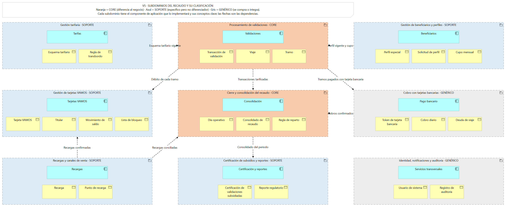

**Análisis.** El resultado son **9 subdominios**: **2 core, 5 de soporte y 2 genéricos**. Cada uno corresponde a un servicio de dominio incluido en la Fase 2 (V4). Cada uno tiene el **componente de aplicación** que lo implementará, que en la Fase 5 será su contexto delimitado, y sus **conceptos clave** como objetos de negocio. Las flechas son las dependencias de información entre subdominios: todo converge en *Validaciones*, y de ahí fluye hacia *Consolidación*.

| Subdominio | Clasificación | Componente (futuro contexto) | Servicio de dominio en V4 | Conceptos clave | Argumento |
|---|---|---|---|---|---|
| Gestión tarifaria | **Soporte** | Tarifas | Gestión tarifaria | Esquema tarifario, Regla de transbordo | Mantiene y versiona el esquema que aplica Validaciones; cambia una vez al año por decreto y exige doble control. Es la configuración del core, no el core |
| Procesamiento de validaciones | **Core** | Validaciones | Procesamiento de validaciones | Transacción de validación, Viaje, Tramo | Aquí se cumple la promesa de la solicitud: cobrar a cada usuario la tarifa que le corresponde, con perfiles, cupos y transbordos entre tres modos. Las reglas son propias de Villa Andina, hoy causan ≈4 % de errores y ningún producto las trae resueltas; un error afecta el ingreso y la confianza |
| Gestión de beneficiarios y perfiles | **Soporte** | Beneficiarios | Gestión de beneficiarios y perfiles | Perfil especial, Solicitud de perfil, Cupo mensual | Específico de las normas locales (acuerdo municipal, cupos, vigencias), pero su función es habilitar la tarifa correcta: alimenta a Validaciones. Cambia todos los días y lo opera la coordinación de beneficiarios (H13) |
| Gestión de tarjetas VAMOS | **Soporte** | Tarjetas VAMOS | Gestión de tarjetas VAMOS | Tarjeta VAMOS, Titular, Movimiento de saldo, Lista de bloqueo | Imprescindible (≈1 millón de tarjetas y ≈9.000 millones de saldo), pero gestionar tarjetas de valor almacenado es un problema conocido y no es lo que diferencia al SIT: la diferencia está en cómo se cobra (Validaciones) |
| Cierre y consolidación del recaudo | **Core** | Consolidación | Cierre y consolidación del recaudo | Día operativo, Consolidado de recaudo, Regla de reparto | Desde 2028 la base para distribuir los ingresos depende de Metro Andino y no de la URA (H15). Imputar cada validación a modo, ruta o estación y operador, con cierre provisional y definitivo, sostiene la neutralidad entre operadores y la conciliación en 3 días; es estratégico y propio del SIT |
| Cobro con tarjetas bancarias | **Genérico** | Pago bancario | Cobro con tarjetas bancarias | Token de tarjeta bancaria, Cobro diario, Deuda de viaje | El pago abierto con tarjetas sin contacto sigue reglas de las franquicias y existe como producto de adquirentes y proveedores de pago: se integra en lugar de construirse |
| Recargas y canales de venta | **Soporte** | Recargas | Gestión de recargas y canales de venta | Recarga, Punto de recarga | Necesario para que el dinero entre al sistema y para la meta de recarga digital, pero vender y recargar es un proceso común de comercio con la red de puntos y la pasarela |
| Certificación de subsidios y reportes | **Soporte** | Certificación y reportes | Certificación de subsidios y reportes | Certificación de validaciones subsidiadas, Reporte regulatorio | Responde al hallazgo de la Contraloría y a la autoridad, pero solo resume información de Consolidación en formatos de terceros |
| Identidad, notificaciones y auditoría | **Genérico** | Servicios transversales | Identidad y permisos, Notificaciones al usuario, Auditoría y trazabilidad | Usuario de sistema, Registro de auditoría | Cualquier organización los necesita; se resuelven con productos o servicios estándar |

**Decisiones.**
- **Dos subdominios core.** *Validaciones* es donde se cumple la solicitud ("la tarifa que les corresponde"). *Consolidación* es la base neutral de distribución que Metro Andino asume en 2028. Como en el ejemplo del curso de préstamos (3 core de 7 subdominios), puede haber más de un core.
- **Tarjetas VAMOS es soporte y no core.** Gestionar tarjetas de valor almacenado es un problema conocido; lo que diferencia al SIT es cómo se cobra cada tramo.
- **Pago bancario es genérico.** Se apoya en las reglas de las franquicias y en productos de adquirentes. Por eso en V4b va con una capa anticorrupción hacia el adquirente.
- **Notación.** Siguiendo la tabla de vistas del enunciado: una **agrupación** por subdominio (con la clasificación en su nombre, su color y una propiedad), el **componente de aplicación** (capa de aplicación) y los **objetos de negocio**. El componente *realiza* el servicio de dominio de V4, lo que conecta esta fase con la anterior.

### V7 Lenguaje ubicuo
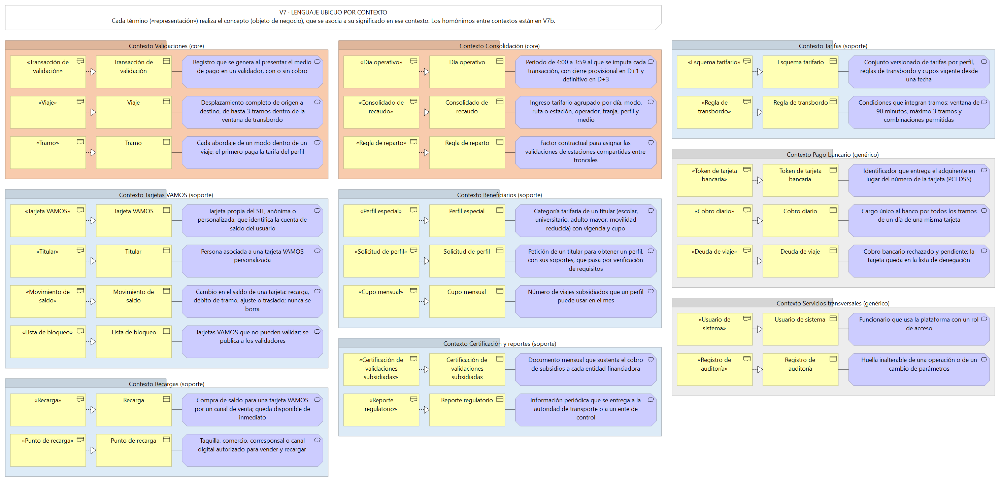

**Análisis.** El glosario tiene un término por cada concepto clave, agrupados por contexto. En ArchiMate se usa el patrón que recomienda el enunciado: el término es una **representación** («…») que *realiza* el **objeto de negocio**, y este se *asocia* a su **significado** en ese contexto. Los nombres de los elementos de todas las vistas usan estos términos.

| Término | Definición | Contexto | Ejemplo |
|---|---|---|---|
| Esquema tarifario | Conjunto versionado de tarifas por perfil, reglas de transbordo y cupos vigente desde una fecha | Tarifas | Esquema 2028, vigente desde el 10 de enero |
| Regla de transbordo | Condiciones que integran tramos: ventana de 90 minutos, máximo 3 tramos y combinaciones permitidas | Tarifas | Alimentador -> metro dentro de la ventana: 0 pesos |
| Transacción de validación | Registro que se genera al presentar el medio de pago en un validador, con o sin cobro | Validaciones | 380.000 validaciones en un día hábil |
| Viaje | Desplazamiento completo de origen a destino, de hasta 3 tramos dentro de la ventana de transbordo | Validaciones | Casa -> alimentador -> metro: 1 viaje con 2 tramos |
| Tramo | Cada abordaje de un modo dentro de un viaje; el primero paga la tarifa del perfil | Validaciones | Segundo tramo en metro a 0 pesos |
| Perfil especial | Categoría tarifaria de un titular (escolar, universitario, adulto mayor, movilidad reducida) con vigencia y cupo | Beneficiarios | Perfil universitario vigente hasta el 31 de julio |
| Solicitud de perfil | Petición de un titular para obtener un perfil, con sus soportes, que pasa por verificación de requisitos | Beneficiarios | Solicitud con certificado de matrícula |
| Cupo mensual | Número de viajes subsidiados que un perfil puede usar en el mes | Beneficiarios | 50 viajes escolares al mes |
| Tarjeta VAMOS | Tarjeta propia del SIT, anónima o personalizada, que identifica la cuenta de saldo del usuario | Tarjetas VAMOS | VAMOS personalizada de Ana |
| Titular | Persona asociada a una tarjeta VAMOS personalizada | Tarjetas VAMOS | El titular pide el bloqueo |
| Movimiento de saldo | Cambio en el saldo de una tarjeta: recarga, débito de tramo, ajuste o traslado; nunca se borra | Tarjetas VAMOS | Abono de 3.100 pesos por cobro sin paso |
| Lista de bloqueo | Tarjetas VAMOS que no pueden validar; se publica a los validadores | Tarjetas VAMOS | Tarjeta reportada como perdida |
| Día operativo | Periodo de 4:00 a 3:59 al que se imputa cada transacción, con cierre provisional en D+1 y definitivo en D+3 | Consolidación | Una validación a las 2:00 pertenece al día anterior |
| Consolidado de recaudo | Ingreso tarifario agrupado por día, modo, ruta o estación, operador, franja, perfil y medio | Consolidación | Consolidado del lunes |
| Regla de reparto | Factor contractual para asignar las validaciones de estaciones compartidas entre troncales | Consolidación | Estaciones del corredor central 50/50 |
| Token de tarjeta bancaria | Identificador que entrega el adquirente en lugar del número de la tarjeta (PCI DSS) | Pago bancario | Token de la tarjeta de un visitante |
| Cobro diario | Cargo único al banco por todos los tramos de un día de una misma tarjeta | Pago bancario | Un cargo de 3.100 pesos por 2 tramos |
| Deuda de viaje | Cobro bancario rechazado y pendiente; la tarjeta queda en la lista de denegación | Pago bancario | 3.100 pesos no cobrados |
| Recarga | Compra de saldo para una tarjeta VAMOS por un canal de venta; queda disponible de inmediato | Recargas | Recarga de 20.000 pesos en una tienda |
| Punto de recarga | Taquilla, comercio, corresponsal o canal digital autorizado para vender y recargar | Recargas | Tienda del barrio con datáfono |
| Certificación de validaciones subsidiadas | Documento mensual que sustenta el cobro de subsidios a cada entidad financiadora | Certificación y reportes | Certificado de octubre para la Secretaría de Educación |
| Reporte regulatorio | Información periódica que se entrega a la autoridad de transporte o a un ente de control | Certificación y reportes | Reporte mensual a la Secretaría de Movilidad |
| Usuario de sistema | Funcionario que usa la plataforma con un rol de acceso | Servicios transversales | El usuario «analista01» |
| Registro de auditoría | Huella inalterable de una operación o de un cambio de parámetros | Servicios transversales | Cambio de tarifa aprobado por la Gerente |

### V7b Homónimos entre contextos
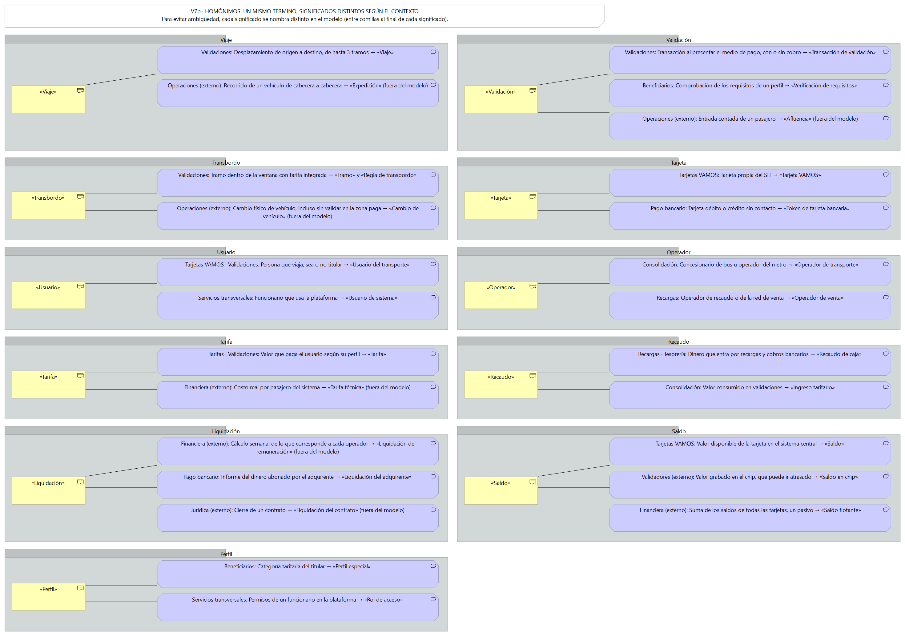

**Análisis.** El enunciado exige dejar explícitos los términos con significados distintos en dos contextos. La entrevista identificó **11 homónimos** (P50). Cada término («representación») se asocia a un significado por contexto, y **cada significado recibe un nombre distinto en el modelo** para que no haya ambigüedad. Por ejemplo, "validación de perfil" se llama *Verificación de requisitos*, y el "recaudo" de Tesorería se distingue del *Ingreso tarifario*.

| Término | Contexto | Significado | Nombre que se usa en el modelo |
|---|---|---|---|
| Viaje | Validaciones | Desplazamiento de origen a destino, de hasta 3 tramos | «Viaje» |
| Viaje | Operaciones (externo) | Recorrido de un vehículo de cabecera a cabecera | «Expedición» (fuera del modelo) |
| Validación | Validaciones | Transacción al presentar el medio de pago, con o sin cobro | «Transacción de validación» |
| Validación | Beneficiarios | Comprobación de los requisitos de un perfil | «Verificación de requisitos» |
| Validación | Operaciones (externo) | Entrada contada de un pasajero | «Afluencia» (fuera del modelo) |
| Transbordo | Validaciones | Tramo dentro de la ventana con tarifa integrada | «Tramo» y «Regla de transbordo» |
| Transbordo | Operaciones (externo) | Cambio físico de vehículo, incluso sin validar en la zona paga | «Cambio de vehículo» (fuera del modelo) |
| Tarjeta | Tarjetas VAMOS | Tarjeta propia del SIT | «Tarjeta VAMOS» |
| Tarjeta | Pago bancario | Tarjeta débito o crédito sin contacto | «Token de tarjeta bancaria» |
| Usuario | Tarjetas VAMOS - Validaciones | Persona que viaja, sea o no titular | «Usuario del transporte» |
| Usuario | Servicios transversales | Funcionario que usa la plataforma | «Usuario de sistema» |
| Operador | Consolidación | Concesionario de bus u operador del metro | «Operador de transporte» |
| Operador | Recargas | Operador de recaudo o de la red de venta | «Operador de venta» |
| Tarifa | Tarifas - Validaciones | Valor que paga el usuario según su perfil | «Tarifa» |
| Tarifa | Financiera (externo) | Costo real por pasajero del sistema | «Tarifa técnica» (fuera del modelo) |
| Recaudo | Recargas - Tesorería | Dinero que entra por recargas y cobros bancarios | «Recaudo de caja» |
| Recaudo | Consolidación | Valor consumido en validaciones | «Ingreso tarifario» |
| Liquidación | Financiera (externo) | Cálculo semanal de lo que corresponde a cada operador | «Liquidación de remuneración» (fuera del modelo) |
| Liquidación | Pago bancario | Informe del dinero abonado por el adquirente | «Liquidación del adquirente» |
| Liquidación | Jurídica (externo) | Cierre de un contrato | «Liquidación del contrato» (fuera del modelo) |
| Saldo | Tarjetas VAMOS | Valor disponible de la tarjeta en el sistema central | «Saldo» |
| Saldo | Validadores (externo) | Valor grabado en el chip, que puede ir atrasado | «Saldo en chip» |
| Saldo | Financiera (externo) | Suma de los saldos de todas las tarjetas, un pasivo | «Saldo flotante» |
| Perfil | Beneficiarios | Categoría tarifaria del titular | «Perfil especial» |
| Perfil | Servicios transversales | Permisos de un funcionario en la plataforma | «Rol de acceso» |

**Sinónimos a evitar (P51).** Se usa *transbordo* (no "trasbordo" ni "integración"), *alimentador* (no "satélite"), *troncal* para el BRT, *taquilla* (no "punto de venta" cuando es en estación) y *expedición* (no "viaje") para el recorrido de un vehículo. Además hay falsos sinónimos que no se deben mezclar:
- recaudo, ingreso y venta;
- validación, viaje y pasajero;
- pasajero validado y pasajero pago;
- liquidación, distribución y pago;
- bloqueo, inactivación y lista de denegación;
- perfil, beneficio y subsidio.

## 6. Agregados, comandos y eventos

### V6 Agregados, comandos y eventos

**Análisis.** Siguiendo el diagrama de agregados con comandos y eventos del curso (presentación de DDD, diapositiva 23), hay **un diagrama por subdominio propio** (8 vistas, V6.1 a V6.8) con **10 agregados**. Cada vista muestra:
- la **estructura** del agregado: la raíz y sus entidades internas y objetos de valor, unidos por composición porque no existen sin la raíz;
- una nota con los **invariantes** que el agregado protege (las reglas que la entrevista marcó como "siempre se cumplen", H20);
- el **gráfico de comandos y eventos**: cada comando (azul) lo atiende una sola raíz y dispara los eventos (amarillo) que emite. Los eventos grises vienen de otro agregado o subdominio y disparan un comando: son las **reacciones** (consistencia eventual entre agregados).

| Vista | Subdominio | Clasificación | Agregados | Imagen |
|---|---|---|---|---|
| V6.1 | Validaciones | Core | Transacción de validación, Viaje | [`v06-1-agregados-comandos-y-eventos-validaciones.png`](vistas/v06-1-agregados-comandos-y-eventos-validaciones.png) |
| V6.2 | Consolidación | Core | Día operativo | [`v06-2-agregados-comandos-y-eventos-consolidacion.png`](vistas/v06-2-agregados-comandos-y-eventos-consolidacion.png) |
| V6.3 | Tarjetas VAMOS | Soporte | Tarjeta VAMOS, Titular | [`v06-3-agregados-comandos-y-eventos-tarjetas-vamos.png`](vistas/v06-3-agregados-comandos-y-eventos-tarjetas-vamos.png) |
| V6.4 | Beneficiarios | Soporte | Perfil especial | [`v06-4-agregados-comandos-y-eventos-beneficiarios.png`](vistas/v06-4-agregados-comandos-y-eventos-beneficiarios.png) |
| V6.5 | Tarifas | Soporte | Esquema tarifario | [`v06-5-agregados-comandos-y-eventos-tarifas.png`](vistas/v06-5-agregados-comandos-y-eventos-tarifas.png) |
| V6.6 | Recargas | Soporte | Recarga | [`v06-6-agregados-comandos-y-eventos-recargas.png`](vistas/v06-6-agregados-comandos-y-eventos-recargas.png) |
| V6.7 | Certificación y reportes | Soporte | Certificación, Reporte regulatorio | [`v06-7-agregados-comandos-y-eventos-certificacion-y-reportes.png`](vistas/v06-7-agregados-comandos-y-eventos-certificacion-y-reportes.png) |
| V6.8 | Pago bancario | Genérico | Cuenta bancaria de viaje | [`v06-8-agregados-comandos-y-eventos-pago-bancario.png`](vistas/v06-8-agregados-comandos-y-eventos-pago-bancario.png) |

*Servicios transversales* (genérico) no tiene vista V6: identidad, notificaciones y auditoría se resuelven con productos estándar y no tienen reglas propias del negocio que proteger.

**Reacciones clave entre contextos.** El evento *Tramo tarificado* (Validaciones) dispara cuatro comandos en otros contextos:
- *Debitar tramo* en Tarjetas VAMOS;
- *Consumir cupo* en Beneficiarios;
- *Imputar tramo* en Consolidación;
- *Registrar tramo bancario* en Pago bancario.

Además, *Recarga confirmada* dispara *Acreditar recarga*; si la acreditación se rechaza, *Reversar recarga* compensa. *Recarga conciliada* dispara *Registrar recaudo de caja* en Consolidación, para la conciliación de caja y el reporte al ERP. *Día cerrado definitivamente* dispara la certificación y los reportes. Así cada agregado protege solo sus invariantes y la coordinación queda en eventos, como recomienda el curso.

#### V6.1 Validaciones (core)
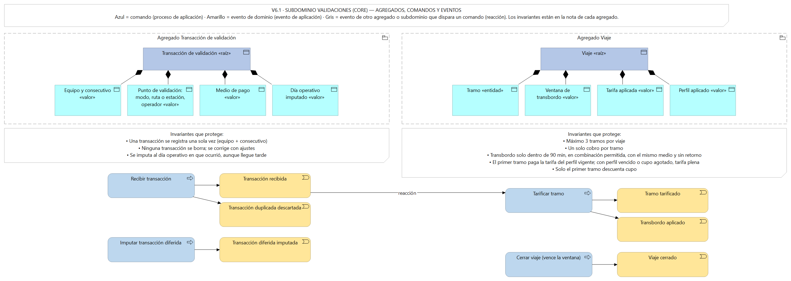

Agregados: *Transacción de validación*, *Viaje*.

#### V6.2 Consolidación (core)
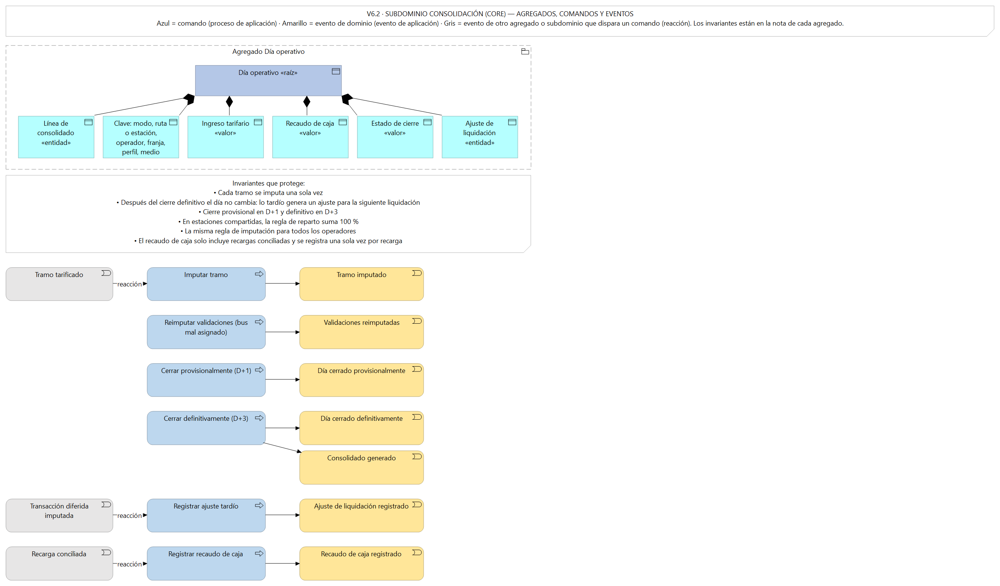

Agregados: *Día operativo*.

#### V6.3 Tarjetas VAMOS (soporte)
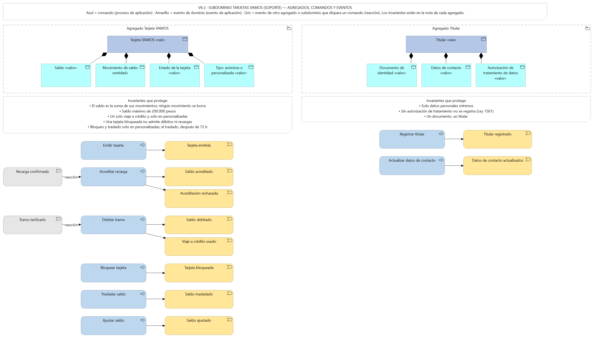

Agregados: *Tarjeta VAMOS*, *Titular*.

#### V6.4 Beneficiarios (soporte)
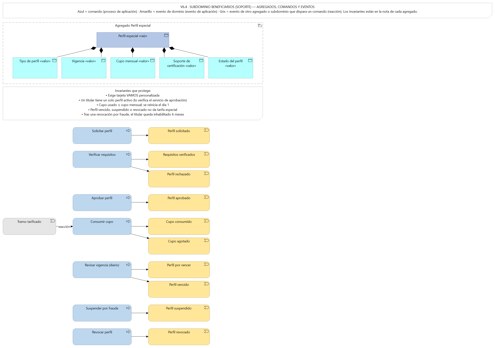

Agregados: *Perfil especial*.

#### V6.5 Tarifas (soporte)
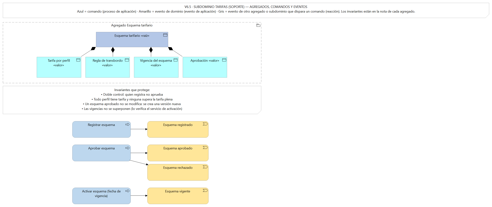

Agregados: *Esquema tarifario*.

#### V6.6 Recargas (soporte)
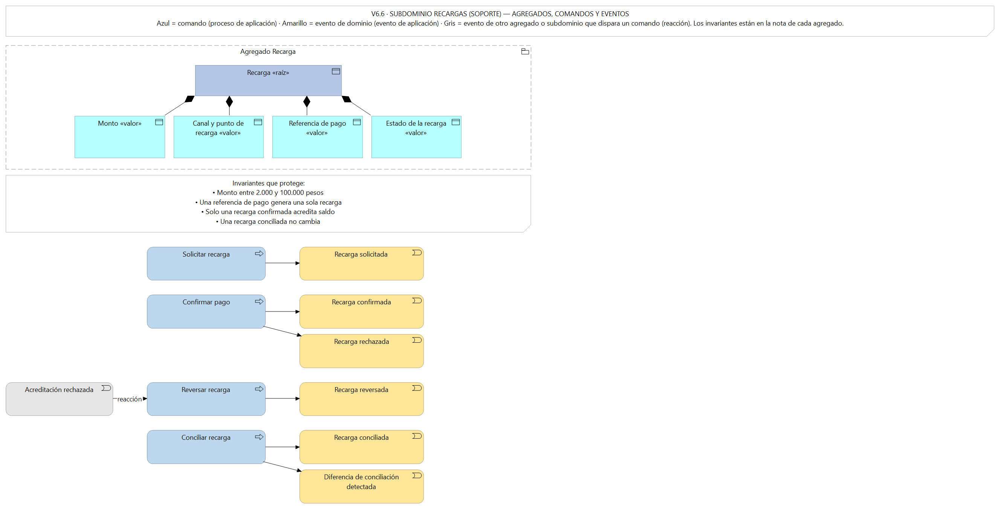

Agregados: *Recarga*.

#### V6.7 Certificación y reportes (soporte)
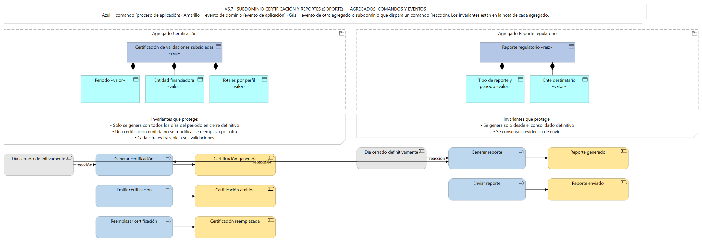

Agregados: *Certificación*, *Reporte regulatorio*.

#### V6.8 Pago bancario (genérico)
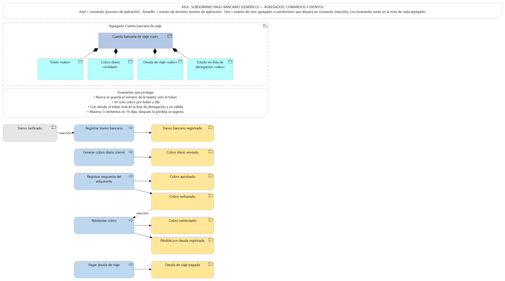

Agregados: *Cuenta bancaria de viaje*.

### Fichas de agregados

| Contexto | Agregado | Raíz | Entidades internas | Objetos de valor | Invariantes | Comandos -> eventos | Alcance (por qué este límite) |
|---|---|---|---|---|---|---|---|
| Validaciones | **Transacción de validación** | Transacción de validación | - | Equipo y consecutivo, Punto de validación: modo, ruta o estación, operador, Medio de pago, Día operativo imputado | • Una transacción se registra una sola vez (equipo + consecutivo) • Ninguna transacción se borra; se corrige con ajustes • Se imputa al día operativo en que ocurrió, aunque llegue tarde | *Recibir transacción* -> Transacción recibida, Transacción duplicada descartada *Imputar transacción diferida* -> Transacción diferida imputada | Se separa de Viaje porque llega del equipo, a veces días después, y debe registrarse una sola vez aunque el viaje ya esté cerrado: su consistencia es de recepción, no de tarifa |
| Validaciones | **Viaje** | Viaje | Tramo | Ventana de transbordo, Tarifa aplicada, Perfil aplicado | • Máximo 3 tramos por viaje • Un solo cobro por tramo • Transbordo solo dentro de 90 min, en combinación permitida, con el mismo medio y sin retorno • El primer tramo paga la tarifa del perfil vigente; con perfil vencido o cupo agotado, tarifa plena • Solo el primer tramo descuenta cupo | *Tarificar tramo* -> Tramo tarificado, Transbordo aplicado (reacciona a: Transacción recibida) *Cerrar viaje (vence la ventana)* -> Viaje cerrado | Agrupa los tramos que comparten una ventana de transbordo: la tarifa de un tramo depende de los anteriores, así que deben ser consistentes en la misma transacción. El saldo queda fuera (Tarjetas VAMOS) porque una tarjeta se usa en muchos viajes |
| Consolidación | **Día operativo** | Día operativo | Línea de consolidado, Ajuste de liquidación | Clave: modo, ruta o estación, operador, franja, perfil, medio, Ingreso tarifario, Recaudo de caja, Estado de cierre | • Cada tramo se imputa una sola vez • Después del cierre definitivo el día no cambia: lo tardío genera un ajuste para la siguiente liquidación • Cierre provisional en D+1 y definitivo en D+3 • En estaciones compartidas, la regla de reparto suma 100 % • La misma regla de imputación para todos los operadores • El recaudo de caja solo incluye recargas conciliadas y se registra una sola vez por recarga | *Imputar tramo* -> Tramo imputado (reacciona a: Tramo tarificado) *Reimputar validaciones (bus mal asignado)* -> Validaciones reimputadas *Cerrar provisionalmente (D+1)* -> Día cerrado provisionalmente *Cerrar definitivamente (D+3)* -> Día cerrado definitivamente, Consolidado generado *Registrar ajuste tardío* -> Ajuste de liquidación registrado (reacciona a: Transacción diferida imputada) *Registrar recaudo de caja* -> Recaudo de caja registrado (reacciona a: Recarga conciliada) | El estado de cierre y los totales del día deben ser consistentes entre sí; cada línea del consolidado solo tiene sentido dentro de su día |
| Tarjetas VAMOS | **Tarjeta VAMOS** | Tarjeta VAMOS | Movimiento de saldo | Saldo, Estado de la tarjeta, Tipo: anónima o personalizada | • El saldo es la suma de sus movimientos; ningún movimiento se borra • Saldo máximo de 200.000 pesos • Un solo viaje a crédito y solo en personalizadas • Una tarjeta bloqueada no admite débitos ni recargas • Bloqueo y traslado solo en personalizadas; el traslado, después de 72 h | *Emitir tarjeta* -> Tarjeta emitida *Acreditar recarga* -> Saldo acreditado, Acreditación rechazada (reacciona a: Recarga confirmada) *Debitar tramo* -> Saldo debitado, Viaje a crédito usado (reacciona a: Tramo tarificado) *Bloquear tarjeta* -> Tarjeta bloqueada *Trasladar saldo* -> Saldo trasladado *Ajustar saldo* -> Saldo ajustado | El saldo y sus movimientos deben ser consistentes en cada débito, recarga o ajuste. El titular queda fuera porque puede tener varias tarjetas y sus datos cambian por otras razones |
| Tarjetas VAMOS | **Titular** | Titular | — | Documento de identidad, Datos de contacto, Autorización de tratamiento de datos | • Solo datos personales mínimos • Sin autorización de tratamiento no se registra (Ley 1581) • Un documento, un titular | *Registrar titular* -> Titular registrado *Actualizar datos de contacto* -> Datos de contacto actualizados | Datos personales protegidos que comparten Tarjetas VAMOS y Beneficiarios; los demás agregados lo referencian por su id |
| Beneficiarios | **Perfil especial** | Perfil especial | -
- | Tipo de perfil, Vigencia, Cupo mensual, Soporte de certificación, Estado del perfil | • Exige tarjeta VAMOS personalizada • Un titular tiene un solo perfil activo (lo verifica el servicio de aprobación) • Cupo usado ≤ cupo mensual; se reinicia el día 1 • Perfil vencido, suspendido o revocado no da tarifa especial • Tras una revocación por fraude, el titular queda inhabilitado 6 meses | *Solicitar perfil* -> Perfil solicitado *Verificar requisitos* -> Requisitos verificados, Perfil rechazado *Aprobar perfil* -> Perfil aprobado *Consumir cupo* -> Cupo consumido, Cupo agotado (reacciona a: Tramo tarificado) *Revisar vigencia (diario)* -> Perfil por vencer, Perfil vencido *Suspender por fraude* -> Perfil suspendido *Revocar perfil* -> Perfil revocado | Vigencia, cupo y estado cambian juntos y deciden la tarifa. La solicitud es el inicio del ciclo de vida del perfil, no otro agregado |
| Tarifas | **Esquema tarifario** | Esquema tarifario | - | Tarifa por perfil, Regla de transbordo, Vigencia del esquema, Aprobación | • Doble control: quien registra no aprueba • Todo perfil tiene tarifa y ninguna supera la tarifa plena • Un esquema aprobado no se modifica: se crea una versión nueva • Las vigencias no se superponen (lo verifica el servicio de activación) | *Registrar esquema* -> Esquema registrado *Aprobar esquema* -> Esquema aprobado, Esquema rechazado *Activar esquema (fecha de vigencia)* -> Esquema vigente | Las tarifas por perfil y las reglas de transbordo se aprueban y entran en vigencia juntas, por decreto; una versión aprobada es inmutable |
| Recargas | **Recarga** | Recarga | - | Monto, Canal y punto de recarga, Referencia de pago, Estado de la recarga | • Monto entre 2.000 y 100.000 pesos • Una referencia de pago genera una sola recarga • Solo una recarga confirmada acredita saldo • Una recarga conciliada no cambia | *Solicitar recarga* -> Recarga solicitada *Confirmar pago* -> Recarga confirmada, Recarga rechazada *Reversar recarga* -> Recarga reversada (reacciona a: Acreditación rechazada) *Conciliar recarga* -> Recarga conciliada, Diferencia de conciliación detectada | Cada pago es independiente y se concilia por separado. Acreditar el saldo es responsabilidad de Tarjetas VAMOS (consistencia eventual); si la acreditación se rechaza, la recarga se reversa (compensación) |
| Certificación y reportes | **Certificación** | Certificación de validaciones subsidiadas | - | Periodo, Entidad financiadora, Totales por perfil | • Solo se genera con todos los días del periodo en cierre definitivo • Una certificación emitida no se modifica: se reemplaza por otra • Cada cifra es trazable a sus validaciones | *Generar certificación* -> Certificación generada (reacciona a: Día cerrado definitivamente) *Emitir certificación* -> Certificación emitida *Reemplazar certificación* -> Certificación reemplazada | Una certificación por periodo y entidad financiadora; se emite completa o no se emite |
| Certificación y reportes | **Reporte regulatorio** | Reporte regulatorio | - | Tipo de reporte y periodo, Ente destinatario | • Se genera solo desde el consolidado definitivo • Se conserva la evidencia de envío | *Generar reporte* -> Reporte generado (reacciona a: Día cerrado definitivamente) *Enviar reporte* -> Reporte enviado | Cada reporte es una entrega independiente a un ente, con su propia evidencia |
| Pago bancario | **Cuenta bancaria de viaje** | Cuenta bancaria de viaje | Cobro diario | Token, Deuda de viaje, Estado en lista de denegación | • Nunca se guarda el número de la tarjeta, solo el token • Un solo cobro por token y día • Con deuda, el token está en la lista de denegación y no valida • Máximo 3 reintentos en 10 días; después la pérdida se registra | *Registrar tramo bancario* -> Tramo bancario registrado (reacciona a: Tramo tarificado) *Generar cobro diario (cierre)* -> Cobro diario enviado *Registrar respuesta del adquirente* -> Cobro aprobado, Cobro rechazado *Reintentar cobro* -> Cobro reintentado, Pérdida por deuda registrada (reacciona a: Cobro rechazado) *Pagar deuda de viaje* -> Deuda de viaje pagada | Los tramos del día de un token se agregan en un solo cobro y la deuda bloquea el token: cobro, deuda y lista de denegación cambian juntos |

**Decisiones.**
- **Notación**, siguiendo la tabla de vistas del enunciado: la raíz, las entidades y los objetos de valor son **objetos de datos**, con el tipo en el nombre («raíz», «entidad», «valor») y en la propiedad `tipo_ddd`. Los comandos son **procesos de aplicación** y los eventos de dominio son **eventos de aplicación**, con los colores azul y amarillo del curso. El límite del agregado es una **agrupación**. Cada raíz *realiza* el objeto de negocio del glosario (V7), y el componente de aplicación del subdominio *accede* a la raíz.
- **Validaciones tiene dos agregados.** *Transacción de validación* garantiza que cada transacción llegue una sola vez, aunque llegue días después. *Viaje* garantiza la tarifa del tramo según los tramos anteriores. Si fueran uno, una transacción tardía tendría que bloquear un viaje ya cerrado.
- **El saldo no está en el Viaje.** Una tarjeta se usa en muchos viajes y el saldo debe ser consistente en cada débito y recarga. Por eso vive en *Tarjeta VAMOS* y el Viaje solo emite *Tramo tarificado*.
- **La solicitud de perfil no es un agregado aparte.** Es el inicio del ciclo de vida del *Perfil especial*, con los estados solicitado, verificado, aprobado, vencido, suspendido y revocado.
- **Invariantes que involucran a varios agregados** ("un titular, un perfil activo" y "vigencias sin superposición") los verifica un servicio de dominio al aprobar o activar, no un agregado. Es la diferencia del curso entre invariantes y políticas del dominio (presentación de DDD, diap. 41).
- **Compensaciones** (apuntes de clase: "siempre una alternativa para deshacer"): *Ajustar saldo*, *Reversar recarga*, *Reimputar validaciones*, *Registrar ajuste tardío*, *Reemplazar certificación* y *Pagar deuda de viaje*.

## 7. Mapa de contextos e interoperabilidad

Cada subdominio de la Fase 3 es un **contexto delimitado**, implementado por su componente de aplicación (relación 1 a 1, como en el ejemplo de préstamos del curso). Los patrones de relación vienen de la literatura de DDD (Evans, 2003; Vernon, 2013), porque la presentación del curso no los detalla. El curso sí los ilustra en código en el proyecto de tránsito (presentación 9b): *BuildingBlocks* como núcleo compartido, *Contracts V1* como lenguaje publicado y la capa anticorrupción en Pagos.

### V8 Mapa de contextos
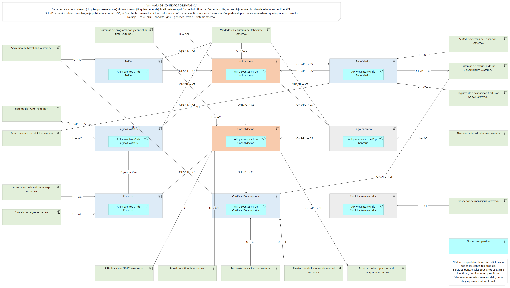

**Análisis.** Cada flecha va del **upstream** (U, quien provee e influye) al **downstream** (D, quien depende). La etiqueta muestra el patrón de cada lado:
- **OHS/PL:** servicio abierto con lenguaje publicado;
- **CS:** cliente–proveedor;
- **CF:** conformista;
- **ACL:** capa anticorrupción;
- **P:** asociación (partnership);
- **U:** sistema externo que impone su formato.

Cada contexto que publica tiene su interfaz **"API y eventos v1"**, que es su servicio abierto. Sus contratos llevan sufijo V1, como en el curso.

El mapa tiene tres zonas:
- **Hacia adentro,** *Validaciones* (core) es el centro. Es cliente de *Tarifas* y de *Beneficiarios*, y publica un solo evento, `TramoTarificadoV1`. Cuatro contextos lo consumen y cada uno lo traduce a su propio comando: Tarjetas, Consolidación, Beneficiarios y Pago bancario.
- **Consolidación** (core) es proveedora de *Certificación y reportes* y clienta de *Recargas*, que le publica `RecargaConfirmadaV1` y `RecargaConciliadaV1` para conciliar el recaudo de caja contra el ingreso tarifario y reportarlo al ERP.
- **Hacia afuera,** cuando Metro Andino puede imponer el formato es *upstream* con OHS/PL y el externo se conforma: operadores, universidades, nuevo proveedor de validadores, PQRS. Cuando el formato lo impone el otro, la plataforma se protege con una **ACL** (sistemas legados, adquirente, agregador, SIMAT, URA) o se conforma cuando no hay riesgo de contaminar el modelo (ERP, entes de control, mensajería).

#### Relaciones entre contextos propios

| # | Upstream (U) | Downstream (D) | Patrón lado U | Patrón lado D | Lo que viaja (lenguaje publicado) | Estilo | Justificación |
|---|---|---|---|---|---|---|---|
| R1 | Tarifas | Validaciones | OHS/PL | Cliente-proveedor | `EsquemaTarifarioVigenteV1` | Consulta y evento al activar | Validaciones (core) es el cliente: Tarifas planea sus versiones según lo que Validaciones necesita y publica el esquema versionado |
| R2 | Beneficiarios | Validaciones | OHS/PL | Cliente-proveedor | `PerfilVigenteV1` | Evento al aprobar, vencer o suspender | Validaciones necesita el perfil vigente de cada tarjeta; Beneficiarios lo publica cada vez que cambia |
| R3 | Validaciones | Tarjetas VAMOS | OHS/PL | Cliente-proveedor | `TramoTarificadoV1` | Asíncrono (evento) | Un solo evento publicado para todos los consumidores; Tarjetas lo traduce a su comando Debitar tramo |
| R4 | Validaciones | Consolidación | OHS/PL | Cliente-proveedor | `TramoTarificadoV1` | Asíncrono (evento) | Consolidación lo traduce a Imputar tramo |
| R5 | Validaciones | Beneficiarios | OHS/PL | Cliente-proveedor | `TramoTarificadoV1` | Asíncrono (evento) | Beneficiarios lo traduce a Consumir cupo |
| R6 | Validaciones | Pago bancario | OHS/PL | Cliente–proveedor | `TramoTarificadoV1` | Asíncrono (evento) | Pago bancario lo traduce a Registrar tramo bancario |
| R7 | Pago bancario | Consolidación | OHS/PL | Cliente–proveedor | `CobroAprobadoV1` | Asíncrono (evento) | Consolidación incorpora los cobros bancarios confirmados a la conciliación |
| R8 | Consolidación | Certificación y reportes | OHS/PL | Cliente–proveedor | `DiaCerradoDefinitivamenteV1 y consolidado` | Asíncrono (evento) | Certificación solo resume el consolidado definitivo |
| R9 | Recargas | Consolidación | OHS/PL | Cliente–proveedor | `RecargaConfirmadaV1 - RecargaConciliadaV1` | Asíncrono (evento) | Consolidación necesita las recargas para la conciliación de caja (recaudo de caja frente a ingreso tarifario) y el reporte al ERP |
| R10 | Recargas | Tarjetas VAMOS | Asociación | Asociación | `RecargaConfirmadaV1 - AcreditacionRechazadaV1` | Asíncrono en ambos sentidos | Se necesitan mutuamente (acreditar y compensar) y los opera la misma gerencia: evolucionan coordinados |
| R11 | Núcleo compartido | Todos los contextos propios | Núcleo compartido | Núcleo compartido | Dinero, identificadores, día operativo | Librería compartida | Conceptos idénticos en todos los contextos (BuildingBlocks del curso, 9b) |
| R12 | Servicios transversales | Todos los contextos propios | OHS | Cliente–proveedor | Identidad, notificaciones y auditoría | Síncrono y eventos | Genérico, sirve a todos por una API estándar |

#### Relaciones con sistemas externos

| # | Upstream (U) | Downstream (D) | Patrón lado U | Patrón lado D | Información | Servicio de la Fase 2 | Justificación |
|---|---|---|---|---|---|---|---|
| X1 | Validadores y sistema del fabricante | Validaciones | Protocolo del fabricante | ACL | Transacciones de validación | Intercambio con validadores | Los 2.600 equipos actuales mantienen el protocolo del fabricante; el ACL lo traduce a Transacción de validación |
| X2 | Tarjetas VAMOS | Validadores y sistema del fabricante | OHS/PL | Conformista | Lista de bloqueo | Intercambio con validadores | Metro Andino impone el formato al nuevo proveedor por contrato (H31); para los equipos actuales traduce el ACL |
| X3 | Tarifas | Validadores y sistema del fabricante | OHS/PL | Conformista | Esquema tarifario vigente | Intercambio con validadores | Igual que la lista de bloqueo |
| X4 | Pago bancario | Validadores y sistema del fabricante | OHS/PL | Conformista | Lista de denegación | Intercambio con validadores | Igual que la lista de bloqueo |
| X5 | Plataforma del adquirente | Pago bancario | Adquirente y franquicias | ACL | Cobros, rechazos y contracargos | Intercambio con el adquirente y las franquicias | El formato lo imponen el adquirente y las franquicias; el ACL traduce y garantiza que solo entre el token (PCI DSS) |
| X6 | Agregador de la red de recarga | Recargas | Agregador | ACL | Recargas y conciliación | Intercambio con la red de recarga y la pasarela de pagos | El agregador define su formato y hoy hay diferencias diarias de conciliación |
| X7 | Pasarela de pagos | Recargas | Pasarela | ACL | Pagos de recarga web y app | Intercambio con la red de recarga y la pasarela de pagos | Formato propio de la pasarela |
| X8 | SIMAT (Secretaría de Educación) | Beneficiarios | SIMAT | ACL | Matriculados escolares | Recepción de certificaciones de perfiles | Formato nacional del SIMAT que Metro Andino no controla |
| X9 | Beneficiarios | Sistemas de matrícula de las universidades | OHS/PL (plantilla del convenio) | Conformista | Matriculados por semestre | Recepción de certificaciones de perfiles | Metro Andino impone la plantilla por convenio (H31) |
| X10 | Registro de discapacidad (Inclusión Social) | Beneficiarios | Registro de discapacidad | ACL | Validación de casos de discapacidad | Recepción de certificaciones de perfiles | Hoy llega por correo y papel; el ACL aísla el formato de la Secretaría |
| X11 | Sistemas de programación y control de flota | Consolidación | Sistemas legados | ACL | Catálogo de la red y asignación de buses | Recepción del catálogo de la red y la asignación de flota | Sistemas de 2014 que solo exportan archivos; la asignación diaria evita imputar al operador equivocado |
| X12 | Sistemas de programación y control de flota | Validaciones | Sistemas legados | ACL | Catálogo de la red | Recepción del catálogo de la red y la asignación de flota | Mismo ACL del catálogo |
| X13 | ERP financiero (2012) | Consolidación | Formato del ERP | Conformista | Consolidado, recargas, ajustes y saldo flotante (hacia el ERP) | Entrega de información financiera | El ERP de 2012 no se puede cambiar: la plataforma entrega en su formato |
| X14 | Portal de la fiducia | Consolidación | Fiducia | ACL | Extractos de las cuentas recaudadoras | Entrega de información financiera | El portal de la fiducia define el formato |
| X15 | Consolidación | Sistemas de los operadores de transporte | OHS/PL | Conformista | Validaciones por bus, ruta y estación; objeciones | Reporte a operadores de transporte | Metro Andino impone el formato a los operadores por contrato |
| X16 | Tarjetas VAMOS | Sistema de PQRS | OHS/PL | Cliente–proveedor | Historial, ajustes y devoluciones | Intercambio con Servicio al Usuario | Proceso interno: Servicio al Usuario negocia lo que necesita y Metro Andino define el formato |
| X17 | Secretaría de Movilidad | Tarifas | Decreto tarifario | Conformista | Decreto tarifario | Reportes regulatorios y decreto tarifario | El decreto se adopta tal cual; el analista lo registra con doble control |
| X18 | Secretaría de Movilidad | Certificación y reportes | Formato de la Secretaría | Conformista | Reporte mensual de recaudo y demanda (hacia la Secretaría) | Reportes regulatorios y decreto tarifario | Formato impuesto por la autoridad de transporte |
| X19 | Secretaría de Hacienda | Certificación y reportes | Formato de Hacienda | Conformista | Certificación de validaciones subsidiadas (hacia Hacienda) | Reportes regulatorios y decreto tarifario | Formato impuesto por Hacienda |
| X20 | Certificación y reportes | Sistemas de matrícula de las universidades | OHS/PL | Conformista | Uso del subsidio por sus estudiantes | Reportes regulatorios y decreto tarifario | Plantilla del convenio |
| X21 | Plataformas de los entes de control | Certificación y reportes | Plataformas de cada ente | Conformista | Rendición de cuentas y reportes (hacia los entes) | Reportes regulatorios y decreto tarifario | Cada ente impone su plataforma |
| X22 | Sistema central de la URA | Tarjetas VAMOS | Sistema legado (cierre) | ACL | Tarjetas, saldos e historial | Migración y convivencia con la URA | Sistema cerrado que desaparece en 2027: el ACL protege el modelo nuevo de su semántica |
| X23 | Sistema central de la URA | Beneficiarios | Sistema legado (cierre) | ACL | Perfiles | Migración y convivencia con la URA | Mismo ACL de migración |
| X24 | Proveedor de mensajería | Servicios transversales | Proveedor de mensajería | Conformista | Avisos de vencimiento, recarga y bloqueo | Notificaciones al usuario | Servicio genérico: se adopta la API del proveedor |

**Decisiones.**
- **Validaciones publica un solo evento** (`TramoTarificadoV1`) en lugar de llamar a cuatro contextos. Así no depende de sus consumidores, como recomienda el curso para microservicios: comunicación asíncrona y sin acoplamiento estrecho.
- **Recargas también es proveedora de Consolidación (OHS/PL -> CS).** El dinero entra por las recargas (recaudo de caja) y se consume en las validaciones (ingreso tarifario); Consolidación necesita ambos para conciliar y para el reporte al ERP. Por eso Recargas publica su propia API y eventos v1.
- **Recargas y Tarjetas VAMOS son una asociación (A).** Se necesitan mutuamente (acreditar la recarga y compensarla si se rechaza) y los opera la misma gerencia.
- **ERP y entes de control son conformistas, no ACL.** Solo se les entrega información en su formato; no hay datos suyos que puedan contaminar el modelo. En cambio, todo lo que *entra* desde un legado o un tercero pasa por una ACL.
- **El núcleo compartido** (Dinero, identificadores, día operativo) y los **servicios transversales** se relacionan con todos los contextos. Esas relaciones están en el modelo, pero se explican con una nota para no saturar la vista.
- **Notación,** según la tabla de vistas del enunciado: contextos y externos son **componentes de aplicación**, el OHS es una **interfaz de aplicación** y la relación proveedor -> consumidor es **servida por** (*serving*), con el patrón en la etiqueta y en las propiedades `patron_U`, `patron_D`, `mensaje` y `justificacion`.

### V9 Interoperabilidad y anticorrupción
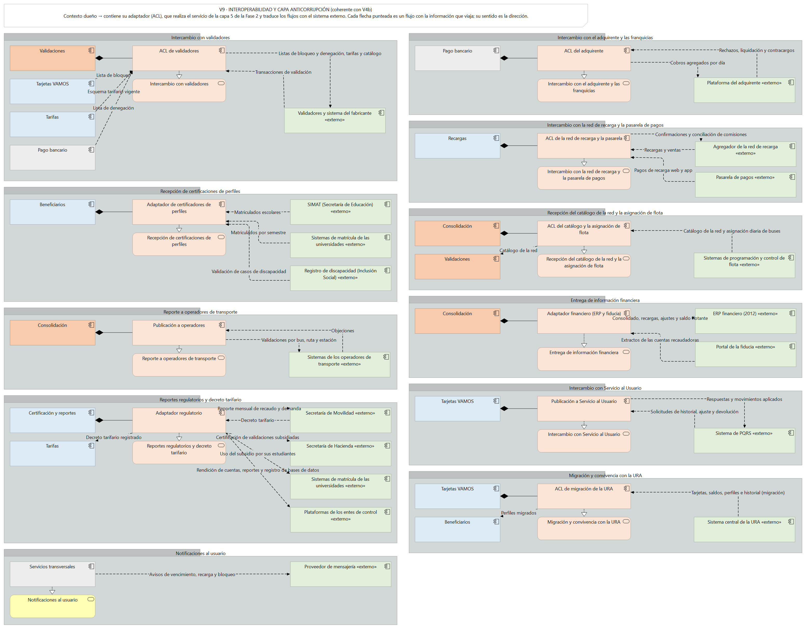

**Análisis.** Es el detalle de cada frontera. El **contexto dueño** contiene su **componente de adaptación**, que *realiza* el servicio de la capa anticorrupción de la Fase 2 (V4b) y traduce los **flujos** con el sistema externo. Cada flujo lleva la información que viaja y su dirección. La información, la dirección y la frecuencia salen de la misma tabla de externos de la Fase 2 (H31), así que las dos fases no pueden contradecirse.

#### Coherencia con la capa anticorrupción de la Fase 2

| Servicio de la capa anticorrupción | Componente que lo realiza | Contexto dueño | Externos | Patrones |
|---|---|---|---|---|
| Intercambio con validadores | ACL de validadores | Validaciones | Validadores y sistema del fabricante | ACL, OHS/PL |
| Intercambio con el adquirente y las franquicias | ACL del adquirente | Pago bancario | Plataforma del adquirente | ACL |
| Intercambio con la red de recarga y la pasarela de pagos | ACL de la red de recarga y la pasarela | Recargas | Agregador de la red de recarga, Pasarela de pagos | ACL |
| Recepción de certificaciones de perfiles | Adaptador de certificadores de perfiles | Beneficiarios | Registro de discapacidad (Inclusión Social), SIMAT (Secretaría de Educación), Sistemas de matrícula de las universidades | ACL, OHS/PL (plantilla del convenio) |
| Recepción del catálogo de la red y la asignación de flota | ACL del catálogo y la asignación de flota | Consolidación | Sistemas de programación y control de flota | ACL |
| Entrega de información financiera | Adaptador financiero (ERP y fiducia) | Consolidación | ERP financiero (2012), Portal de la fiducia | ACL, Conformista |
| Reporte a operadores de transporte | Publicación a operadores | Consolidación | Sistemas de los operadores de transporte | OHS/PL |
| Intercambio con Servicio al Usuario | Publicación a Servicio al Usuario | Tarjetas VAMOS | Sistema de PQRS | OHS/PL |
| Reportes regulatorios y decreto tarifario | Adaptador regulatorio | Certificación y reportes | Plataformas de los entes de control, Secretaría de Hacienda, Secretaría de Movilidad, Sistemas de matrícula de las universidades | Conformista, OHS/PL |
| Migración y convivencia con la URA | ACL de migración de la URA | Tarjetas VAMOS | Sistema central de la URA | ACL |
| Notificaciones al usuario | Servicios transversales (directo) | Servicios transversales | Proveedor de mensajería | Conformista |

**Decisiones.**
- **Un componente de adaptación por servicio de la capa 5,** compuesto dentro de su contexto dueño. Cada uno *realiza* el servicio de negocio de V4, lo que deja trazado el paso de la Fase 2 (negocio) a la Fase 5 (aplicación).
- **El ACL de validadores** lo usan además Tarjetas, Tarifas y Pago bancario para publicar las listas de bloqueo y de denegación y el esquema tarifario. Así se cumple el requerimiento de que la información llegue a los validadores sin que la plataforma gestione los dispositivos (H11).
- **Notificaciones** (capa 7 de la Fase 2) no necesita adaptador propio: *Servicios transversales* se conforma con la API del proveedor de mensajería.
- **Se retiró la DIAN** (H30): la integración del documento equivalente no aplica al transporte urbano.

### V10 Trazabilidad vertical
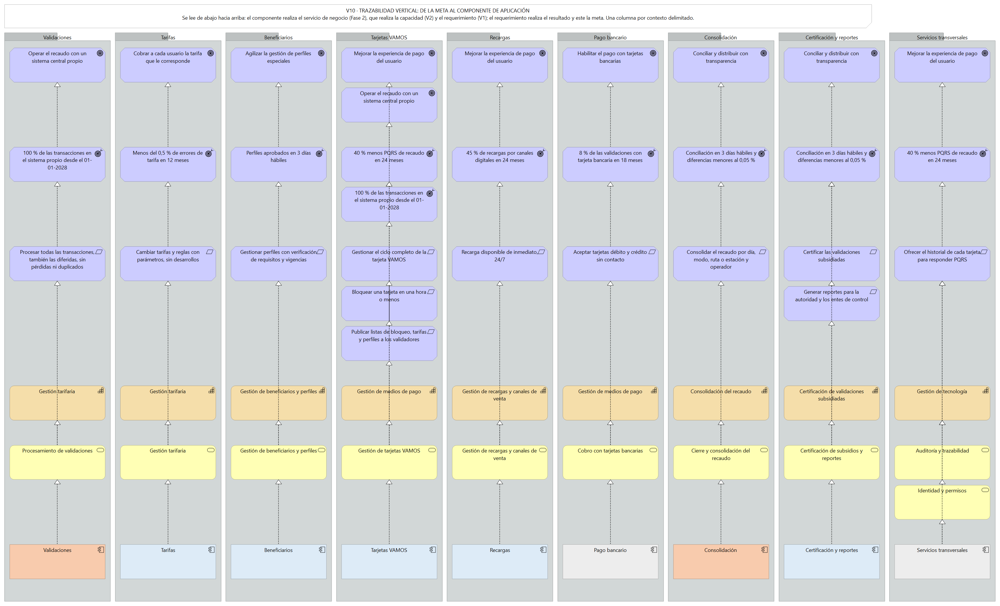

**Análisis.** Hay una columna por cada componente de aplicación (contexto delimitado) y se lee de abajo hacia arriba:
1. el **componente** *realiza* el **servicio de negocio** que diseñamos en la Fase 2;
2. ese servicio *realiza* la **capacidad** del mapa (V2) y el **requerimiento** de la motivación (V1);
3. el requerimiento *realiza* el **resultado** medible;
4. el resultado *realiza* la **meta**.

Así cada componente queda justificado por una meta y una capacidad, como pide el enunciado. Todas las relaciones son de **realización** y están validadas contra la especificación de ArchiMate 3.2. La cadena cruza las cuatro capas: Motivación, Estrategia, Negocio y Aplicación.

| Componente (contexto) | Servicio de negocio que realiza (V4) | Capacidad (V2) | Requerimiento (V1) | Resultado (V1) | Meta (V1) |
|---|---|---|---|---|---|
| Validaciones | Procesamiento de validaciones | Gestión tarifaria | Procesar todas las transacciones, también las diferidas, sin pérdidas ni duplicados | 100 % de las transacciones en el sistema propio desde el 01-01-2028 | Operar el recaudo con un sistema central propio |
| Tarifas | Gestión tarifaria | Gestión tarifaria | Cambiar tarifas y reglas con parámetros, sin desarrollos | Menos del 0,5 % de errores de tarifa en 12 meses | Cobrar a cada usuario la tarifa que le corresponde |
| Beneficiarios | Gestión de beneficiarios y perfiles | Gestión de beneficiarios y perfiles | Gestionar perfiles con verificación de requisitos y vigencias | Perfiles aprobados en 3 días hábiles | Agilizar la gestión de perfiles especiales |
| Tarjetas VAMOS | Gestión de tarjetas VAMOS | Gestión de medios de pago | Gestionar el ciclo completo de la tarjeta VAMOS Bloquear una tarjeta en una hora o menos Publicar listas de bloqueo, tarifas y perfiles a los validadores | 40 % menos PQRS de recaudo en 24 meses 100 % de las transacciones en el sistema propio desde el 01-01-2028 | Mejorar la experiencia de pago del usuario Operar el recaudo con un sistema central propio |
| Recargas | Gestión de recargas y canales de venta | Gestión de recargas y canales de venta | Recarga disponible de inmediato, 24/7 | 45 % de recargas por canales digitales en 24 meses | Mejorar la experiencia de pago del usuario |
| Pago bancario | Cobro con tarjetas bancarias | Gestión de medios de pago | Aceptar tarjetas débito y crédito sin contacto | 8 % de las validaciones con tarjeta bancaria en 18 meses | Habilitar el pago con tarjetas bancarias |
| Consolidación | Cierre y consolidación del recaudo | Consolidación del recaudo | Consolidar el recaudo por día, modo, ruta o estación y operador | Conciliación en 3 días hábiles y diferencias menores al 0,05 % | Conciliar y distribuir con transparencia |
| Certificación y reportes | Certificación de subsidios y reportes | Certificación de validaciones subsidiadas | Certificar las validaciones subsidiadas Generar reportes para la autoridad y los entes de control | Conciliación en 3 días hábiles y diferencias menores al 0,05 % | Conciliar y distribuir con transparencia |
| Servicios transversales | Auditoría y trazabilidad, Identidad y permisos | Gestión de tecnología | Ofrecer el historial de cada tarjeta para responder PQRS | 40 % menos PQRS de recaudo en 24 meses | Mejorar la experiencia de pago del usuario |

**Cómo leerla en la sustentación** (ejemplo con el core): *"El componente **Validaciones** realiza el servicio **Procesamiento de validaciones**. Ese servicio realiza la capacidad **Gestión tarifaria** y el requerimiento **Procesar todas las transacciones, también las diferidas, sin pérdidas ni duplicados**. El requerimiento realiza el resultado **100 % de las transacciones en el sistema propio desde el 01-01-2028**, que realiza la meta **Operar el recaudo con un sistema central propio**."*

**Decisiones.**
- **Los adaptadores (ACL) no tienen columna propia.** Su trazabilidad pasa por su contexto dueño, que los compone (V9), y por el servicio de la capa anticorrupción que realizan (V4b).
- **Servicios transversales** se traza por *Auditoría y trazabilidad* hasta el requerimiento de historial para PQRS y la capacidad *Gestión de tecnología*.
- **En el modelo hay más caminos que en esta vista.** Por ejemplo, el servicio de negocio *sirve* al paso del proceso E2E de V3 y los cursos de acción se asocian a las capacidades. En la vista se dejó solo la cadena meta -> componente para que se pueda leer.

## 8. Bounded Context Canvas

### V11 Bounded Context Canvas
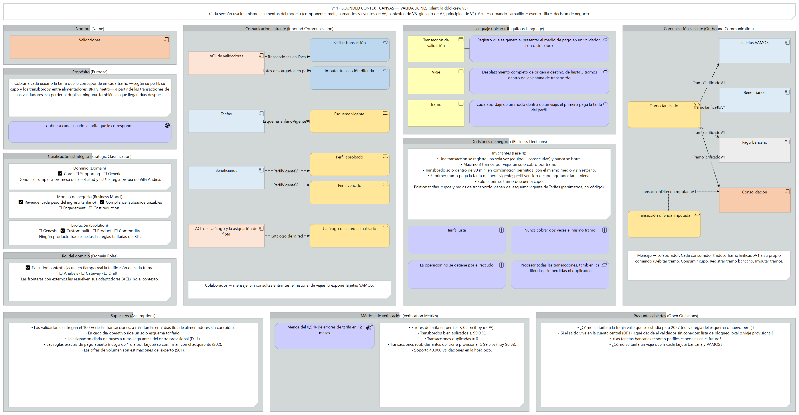

**Análisis.** Es el canvas del contexto principal, **Validaciones** (core), con la plantilla *Bounded Context Canvas v5* de ddd-crew que usa el curso (presentación de DDD, diapositivas 34 y 35). Muestra en una sola página todo lo que exige el enunciado:

| Sección del canvas | Contenido | Sale de |
|---|---|---|
| Nombre | Componente *Validaciones* | V5, V8 |
| Propósito | Cobrar a cada usuario la tarifa que le corresponde en cada tramo, sin perder ni duplicar transacciones; asociado a la meta *Cobrar a cada usuario la tarifa que le corresponde* | V1 |
| Clasificación estratégica | Dominio **core** - modelo de negocio **revenue** y **compliance** - evolución **custom built** | V5 |
| Rol del dominio | **Execution context** | - |
| Comunicación entrante | ACL de validadores -> *Recibir transacción*, *Imputar transacción diferida* (comandos) - Tarifas -> *Esquema vigente* - Beneficiarios -> *Perfil aprobado*, *Perfil vencido* - ACL del catálogo -> *Catálogo de la red actualizado* (eventos) | V6.1, V8, V9 |
| Lenguaje ubicuo | Transacción de validación, Viaje, Tramo, con su significado | V7 |
| Decisiones de negocio | Invariantes de los agregados *Transacción de validación* y *Viaje*; principios *Tarifa justa*, *Nunca cobrar dos veces*, *La operación no se detiene*; requerimiento de procesar todas las transacciones | V6.1, V1 |
| Comunicación saliente | *Tramo tarificado* (`TramoTarificadoV1`) -> Tarjetas VAMOS, Beneficiarios, Pago bancario, Consolidación - *Transacción diferida imputada* -> Consolidación | V6, V8 |
| Supuestos | Entrega de transacciones en ≤ 7 días, un esquema por día operativo, asignación de buses antes de D+1, reglas del adquirente (S02), cifras estimadas (S01) | Hallazgos, -9 |
| Métricas de verificación | Resultado *Menos del 0,5 % de errores de tarifa*; transbordos bien aplicados ≥ 99,9 %; 0 duplicados; ≥ 99,5 % de transacciones antes del cierre provisional; 40.000 validaciones en hora pico | V1, entrevista (P38) |
| Preguntas abiertas | Tarifa en horas valle (2027), validador sin conexión si el saldo vive en la cuenta central (DP1), perfiles con tarjeta bancaria, viajes que mezclan medios | Entrevista, -9 |

**Cómo se construyó en la herramienta (componente investigativo).** Archi ofrece dos caminos:

| Opción | Cómo | Ventaja | Desventaja |
|---|---|---|---|
| A. **Vista ArchiMate maquetada como canvas** (elegida) | Una vista con un grupo por sección de la plantilla, dispuestos como el canvas de ddd-crew, con los **mismos elementos del modelo** dentro de cada sección | El canvas queda **coherente con el modelo por construcción**: si un comando o evento cambia en V6, cambia en el canvas | Hay que maquetarlo para que quepa en una página |
| B. Canvas nativo de Archi (*New -> Blank Canvas*) | Bloques de texto que replican la plantilla | Visualmente idéntico a la plantilla | Los bloques son texto, no elementos del modelo; la coherencia se verifica a mano |

Se eligió **A** porque la rúbrica pide un canvas *"coherente con el modelo"*. Los mensajes entrantes y salientes son los mismos comandos y eventos de V6.1 y las mismas relaciones de V8 y V9. Los colores siguen la plantilla: comando azul, evento amarillo, decisión lila. 

**Decisiones.**
- **Para que el canvas tenga líneas entre colaborador y mensaje se agregaron al modelo:**
  - flujos colaborador -> mensaje, por ejemplo *ACL de validadores -> Recibir transacción*;
  - flujos evento -> consumidor, por ejemplo *Tramo tarificado -> Tarjetas VAMOS*;
  - el evento *Catálogo de la red actualizado*.

  Todos son coherentes con las reacciones de V6 y las relaciones de V8.
- **No hay consultas entrantes:** el historial de viajes para PQRS lo expone Tarjetas VAMOS. Queda anotado en la sección de comunicación entrante.

## 9. Decisiones y supuestos

Con la rúbrica actualizada por el docente, la IA (sesión de arquitectura) **propuso** el diseño y el equipo lo **validó y confirmó**. Cada decisión indica quién la propuso y qué integrante es responsable de validarla y defenderla en la sustentación. Es el dueño de la fase según la [tabla de aportes](#10-tabla-de-aportes).

### 9.1 Decisiones de diseño

| ID | Fase / vista | Decisión | Alternativa descartada | Por qué | Origen | Propuesto por | Responsable de validarla |
|---|---|---|---|---|---|---|---|
| D01 | 0 / entrevista | La IA en rol de experto aportó el conocimiento del negocio en una sesión aparte; lo normativo se contrastó con fuentes oficiales | Usar las cifras y normas tal como las dijo el experto | Lo de la organización ficticia lo define el experto; lo de la realidad colombiana se verifica (3 normas corregidas: H27–H29) | Análisis de hallazgos | IA | Laura |
| D02 | 1 / V2 | Clasificar estratégica, misional o de apoyo **por capacidad**, no por área; desagregar *Gestión administrativa* en 4 capacidades | Clasificar por área; dejar el área administrativa como una sola capacidad | Así lo hace el mapa de la IPS del curso; una capacidad se nombra como una sola cosa | 08-SOA diap. 35 | IA | Laura |
| D03 | 1 / V2, V5 | Separar **Gestión tarifaria** de **Gestión de beneficiarios y perfiles** | Una sola capacidad "tarifas y perfiles" | Cambian a ritmos distintos (anual frente a diario) y tienen responsables distintos | H13 | Experto (corrección) | Laura |
| D04 | 1 / V3 - 2 / V4 | Liquidar y distribuir quedan **fuera** de la aplicación; ella entrega la base de liquidación (DP3) | Incluir la liquidación en la plataforma | La liquidación es de Financiera y el pago de la fiducia | H14 | IA | Laura |
| D05 | 2 / V4 | Usar las **7 capas** de la jerarquía del curso y desglosar en la capa 4 solo los **2 subdominios foco** | Solo las 4 capas mínimas; desglosar todos los subdominios | Cubre la capa anticorrupción, los datos maestros y la infraestructura; desglosar solo el foco sigue el ejemplo de agendamiento de citas y mantiene la vista legible | 08-SOA diap. 20 y 28 | IA | Tomás |
| D06 | 2 / V4b | Un servicio anticorrupción **por frontera** con un externo; se **retira la DIAN** | Un único servicio de integración genérico; mantener la DIAN | Cada frontera tiene un formato y un dueño distintos; la DIAN exceptúa al transporte urbano | H30, H31 | IA | Tomás |
| D07 | 2 / V4c | El contrato de cada servicio anticorrupción es el intercambio de la tabla de externos; los demás servicios incluidos tienen ficha propia | Una ficha completa para cada uno de los 31 contratos | Evita duplicar información que ya está en la tabla de externos | 08-SOA P3 | IA | Tomás |
| D08 | 3 / V5 | **Dos subdominios core** (Validaciones y Consolidación); Tarjetas VAMOS es soporte y Pago bancario es genérico | Un solo core; Tarjetas como core | Validaciones cumple "la tarifa que corresponde" y Consolidación es la base de distribución que Metro Andino asume en 2028; gestionar tarjetas es un problema conocido; el pago abierto existe como producto | H15, H23 | IA | Sebastian Quiceno |
| D09 | 3 / V7b | Cada homónimo recibe un **nombre distinto** en el modelo (p. ej. *Verificación de requisitos*, *Ingreso tarifario* frente a *Recaudo de caja*) | Usar el mismo término con una aclaración | Elimina la ambigüedad en las vistas y en el código futuro | H32 | IA | Sebastian Quiceno |
| D10 | 4 / V6.1 | Validaciones tiene **dos agregados**: *Transacción de validación* y *Viaje* | Un solo agregado | Una transacción tardía no debe bloquear un viaje ya cerrado; sus invariantes son distintos (recepción frente a tarifa) | H17, H20 | IA | Sebastian Quiceno |
| D11 | 4 / V6.3 | El **saldo vive en una cuenta del sistema central** (agregado *Tarjeta VAMOS*), no en el chip (DP1) | Saldo en el chip, como hoy | Permite la recarga inmediata, el bloqueo en ≤ 1 h y el traslado del saldo | H16 | IA | Sebastian Orcasita |
| D12 | 4 / V6 | Los invariantes que involucran varios agregados (un perfil activo por titular, vigencias sin superposición) los verifica un **servicio de dominio** | Meter más entidades en un agregado | Así se distinguen invariantes y políticas del dominio, como en el curso | 09-DDD diap. 41 | IA | Sebastian Orcasita |
| D13 | 4 / V6.8 - 5 | La tarjeta bancaria se identifica por el **token** del adquirente (DP4) | Guardar el número de la tarjeta | Lo exige PCI DSS v4.0.1 y reduce el alcance de la certificación | H28 | IA | Sebastian Orcasita |
| D14 | 5 / V8 | Validaciones publica **un solo evento** (`TramoTarificadoV1`) que cuatro contextos traducen a sus propios comandos | Que Validaciones llame a cada contexto | Desacopla el core de sus consumidores (comunicación asíncrona, como en 9a y 9b) | 09b | IA | Sebastian Orcasita |
| D15 | 5 / V8 | Recargas es **proveedora de Consolidación** (OHS/PL -> CS) con `RecargaConfirmadaV1` y `RecargaConciliadaV1`; con Tarjetas VAMOS es una **asociación** | No relacionar Recargas con Consolidación | Consolidación necesita el recaudo de caja para conciliar y reportar al ERP | Revisión del equipo | **Equipo** | Sebastian Orcasita |
| D16 | 5 / V8, V9 | Con el ERP y los entes de control la plataforma es **conformista**; todo lo que **entra** desde un legado o un tercero pasa por una **ACL** | ACL en todas las fronteras | A quien solo se le entrega información no puede contaminar el modelo | H31 | IA | Sebastian Orcasita |
| D17 | 5 / V9 | La plataforma **publica** las listas de bloqueo y denegación y el esquema tarifario a los validadores (DP2), con una ACL para los 2.600 equipos actuales | Que lo haga el sistema del proveedor | Cumple el requerimiento sin gestionar los dispositivos, que están fuera del alcance | H11 | IA | Sebastian Orcasita |
| D18 | 6 / V11 | El canvas es una **vista ArchiMate maquetada** con los mismos elementos del modelo | Canvas nativo de Archi | Garantiza la coherencia con el modelo que pide la rúbrica | Investigación de la herramienta | IA | Sebastian Quiceno |
| D19 | Todas | El modelo se **genera con un script** que valida cada relación contra ArchiMate 3.2 y conserva la disposición ajustada a mano en Archi | Construirlo solo a mano en Archi | Garantiza relaciones válidas y coherencia entre vistas; el equipo puede seguir ajustando la disposición | `modelo/README.md` | IA | Laura |

### 9.2 Desviaciones de la notación sugerida por el enunciado

El enunciado dice que la columna de elementos de referencia es orientativa y pide justificar cuando se usa otro elemento. Las vistas que no aparecen en esta tabla usan los elementos sugeridos.

| Vista | Sugerido | Usado | Justificación |
|---|---|---|---|
| V3 | Actor de negocio | Actores de negocio (los roles van en V4d) | En el E2E importa quién participa; los roles se precisan al asignarlos a los servicios |
| V4 | Una vista | Cuatro vistas: V4 (capas), V4b (externos), V4c (contratos), V4d (roles, funciones y objetos) | Una sola vista con 42 servicios, 17 externos, 31 contratos y los roles no se podría leer |
| V5 | Agrupación y objeto de negocio | Además, el **componente de aplicación** de cada subdominio | Conecta los dominios con los contextos de V8 y con la trazabilidad de V10, y deja el diseño en la capa de aplicación como pide la Fase 3 |
| V6 | Objeto de negocio y de datos | La raíz, las entidades y los objetos de valor son **objetos de datos** con el tipo en el nombre («raíz», «entidad», «valor»); la raíz *realiza* el objeto de negocio del glosario | ArchiMate no tiene elementos DDD; el tipo en el nombre se lee en la imagen sin abrir Archi |
| V7 | Significado, representación, objeto de negocio | Los mismos; además la vista **V7b** de homónimos | El enunciado exige dejar explícitos los términos con varios significados |
| V8 | Componente, interfaz, servicio, flujo, servida por | Relaciones **servida por** del *upstream* al *downstream*, con el **patrón en la etiqueta** (OHS/PL, CS, CF, ACL, P) y en sus propiedades | ArchiMate no tiene notación para los patrones de contexto; la etiqueta con leyenda es la forma usual |
| V9 | Componente externo | Componente de aplicación marcado «externo» (color verde) | ArchiMate no distingue componentes externos; se marcan con nombre, color y propiedad |
| V10 | Realización, influencia, servicio y asignación | Solo **realización** en la vista | Es la relación que une la cadena componente -> servicio -> capacidad y requerimiento -> resultado -> meta; la influencia (V1) y el servicio (V4) están en el modelo |
| V11 | Libre elección | Grupos por sección con elementos del modelo; las casillas de clasificación son **notas** | ArchiMate no tiene un elemento para opciones de plantilla |

### 9.3 Supuestos

| ID | Supuesto | Por qué se asume | Cómo se validaría | Riesgo si es falso |
|---|---|---|---|---|
| S01 | Las cifras marcadas *(estimación típica)* son representativas | La organización es ficticia | Se declaran como supuestos | Cambia el dimensionamiento, no la estructura |
| S02 | Reglas exactas del adquirente (riesgo de 1 día por tarjeta, 3 reintentos) | El contrato está por negociar | Contrato con el adquirente | Cambian parámetros, no el modelo |
| S03 | No hay obligación de documento equivalente electrónico ante la DIAN | Excepción del transporte urbano (H30) | Concepto de la DIAN para el SIT | Se agrega un externo y un servicio anticorrupción |
| S04 | La edad mínima de adulto mayor es 62 años (decisión local) frente a 60 (Ley 1276) | Decisión de Metro Andino | Jurídica y Concejo | Tutelas; se mitiga porque la edad es un parámetro |
| S05 | Alcance de la cláusula de reversión de datos de la URA | El experto pide verificarlo | Jurídica | Migración incompleta del historial |
| S06 | Los validadores entregan el 100 % de las transacciones a más tardar en 7 días | Capacidad de almacenamiento de los equipos (P23) | Pruebas con el proveedor | Transacciones perdidas que se estiman con conteos manuales |
| S07 | En cada día operativo rige un solo esquema tarifario | Las tarifas cambian por decreto con fecha de vigencia | Resolución tarifaria | Habría que tarificar por hora de validación |
| S08 | La asignación diaria de buses a rutas llega antes del cierre provisional (D+1) | Hoy llega en un archivo nocturno | Integración con el CCO | Reimputaciones frecuentes |

### 9.4 Preguntas abiertas

- ¿Cómo se tarificará la franja valle que se estudia para 2027: una regla nueva del esquema o un perfil nuevo?
- Si el saldo vive en la cuenta central (D11), ¿qué decide un validador sin conexión: una lista de bloqueo local o un viaje provisional?
- ¿Las tarjetas bancarias tendrán perfiles especiales en el futuro?
- ¿Cómo se tarifa un viaje que mezcla tarjeta bancaria y VAMOS?
- ¿Qué tratamiento legal tienen los saldos de tarjetas sin uso por más de 3 años (P52)?

## 10. Tabla de aportes

El trabajo se repartió por **fases completas**, para que cada integrante sea dueño de una parte del razonamiento de punta a punta. El peso se equilibró con la rúbrica. Todos revisaron y validaron el diseño completo para la sustentación por sorteo.

| Integrante | Fases y vistas | Secciones del README y archivos |
|---|---|---|
| Laura Carolina Suárez Lozano | Fase 0 (entrevista al experto) - Fase 1: V1 Motivación, V2 Mapa de capacidades, V3 Cadena de valor y proceso E2E - V10 Trazabilidad vertical | -1 Contexto y entrevista - -2 Motivación - -3 Capacidades y E2E - V10 en -7 - carpeta `/entrevista` |
| Tomás Castaño Peña | Fase 2: V4 Descomposición de servicios, V4b Capa anticorrupción, V4c Contratos, V4d Detalle de los subdominios foco | -4 Descomposición de servicios (tablas de inclusión y exclusión, externos y contratos) - -9 Decisiones y supuestos |
| Sebastian Quiceno | Fase 3: V5 Dominios, V7 Lenguaje ubicuo, V7b Homónimos - Fase 4: V6.1 Validaciones, V6.2 Consolidación - Fase 6: V11 Bounded Context Canvas | -5 Dominios y lenguaje ubicuo - -6 análisis general y fichas de los agregados core - -8 Bounded Context Canvas |
| Sebastian Orcasita Aroca | Fase 4: V6.3 Tarjetas VAMOS, V6.4 Beneficiarios, V6.5 Tarifas, V6.6 Recargas, V6.7 Certificación y reportes, V6.8 Pago bancario - Fase 5: V8 Mapa de contextos, V9 Interoperabilidad y anticorrupción | -6 fichas de los agregados de soporte y genéricos - -7 Mapa de contextos e interoperabilidad |

